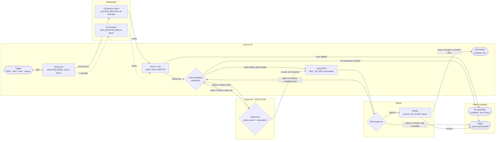
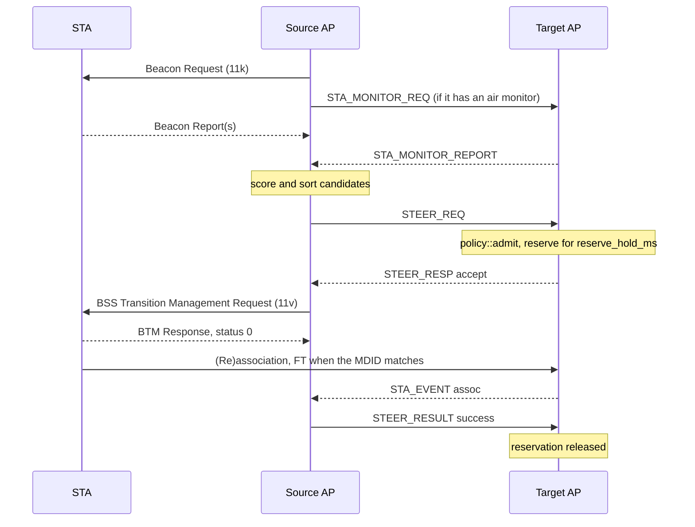

# Steering flow

How DongHoa moves a station (STA) to a better BSS. The source AP, which
serves the STA, runs one transaction per STA through MEASURE, NEGOTIATE,
BTM and ROAM (`src/steer.cpp`). The decision functions are pure and live in
`src/policy.cpp`. The state machine as ASCII, and the parameter list, are in
[ARCHITECTURE.md](ARCHITECTURE.md#steering-state-machine-source-ap-one-transaction-per-sta).
Default values are shown in brackets.

## Flow

## Messages for a remote target

## Steps

1. **Trigger.** A STA is considered only if it supports 11v, has no running
   transaction and is past its cooldown or backoff time.
   - *RSSI* (`isRssiTriggered`): the smoothed RSSI (EWMA, `(3·old + new)/4`)
     is below `rssi_low` [−75 dBm] and the last `rssi_low_count` [3] polls
     were below it too.
   - *Band* (`isBandTriggered`): a 2.4 GHz STA at or above `band_steer_rssi`
     [−55 dBm].
   - *Load* (`runLbRound`, every `lb_interval_ms` [10 s]): a BSS at or above
     `util_high` [70%] or at `max_sta` offloads one STA per round, the weakest
     one (only idle STAs with `lb_only_idle`).
   - *Manual*: `donghoa_cli … STEER`, optionally naming the target.
2. **Pool** (`buildPool`). Every other BSS of the same ESS, on this AP or a
   peer. Band steering keeps only higher bands. An empty pool means a
   cooldown, not a failure. A steer holds 16 BSSes; in a bigger network the
   pool keeps BSSes the STA was recently measured at (best first), then this
   AP's own, then the others, starting each STA's next steer after the peers
   the previous one covered.
3. **MEASURE.** One 802.11k beacon request covers all candidate channels;
   air monitors on candidate APs listen in parallel, so STAs without 11k can
   be steered too. The STA's own reports take priority. MEASURE ends when
   every candidate has a fresh level, or at the deadline.
4. **Score** (`policy::score`). A candidate is out if it is unmeasured
   (except for manual steering), not accepting, full, at or above
   `util_admit_max` [80%], or below `rssi_min_target` [−70 dBm].
   - Model 0 (default): `RSSI + band bonus (5 GHz +5, 6 GHz +8) −
     util_weight [2] × util% / 10`. An RSSI steer must beat the current RSSI
     by `rssi_hysteresis` [8 dB]. A load steer needs a target below
     `util_high − lb_margin` [55%] and may lose at most `lb_rssi_tolerance`
     [5 dB].
   - Model 1 (experimental): expected throughput `q(RSSI) × peak PHY rate ×
     (1 − util)`, which must reach `tput_gain_pct` [150%] of the current
     throughput.
5. **NEGOTIATE.** Candidates are tried best first. A local sibling BSS is
   admitted locally and skips this step. A remote one gets `STEER_REQ`; the
   target checks `sta_count + reservations` against `max_sta` and its load,
   then reserves a slot for `reserve_hold_ms`.
6. **BTM.** `BSS_TM_REQ` with one neighbor at preference 255, with the
   Mobility Domain bit set when the MDID matches.
7. **ROAM.** Success is confirmed by a `STA_EVENT` assoc from the target, not
   by the BTM response. An assoc at another BSS counts as `WRONG_TARGET`,
   which still resets the failure count.
8. **After.** Success: `steer_cooldown_ms` [30 s]. Failure: `steer_cooldown_ms ×
   2^failures`, capped at `steer_backoff_max_ms` [10 min]. Each target that
   was passed over gets a `STEER_RESULT` and releases its reservation.
