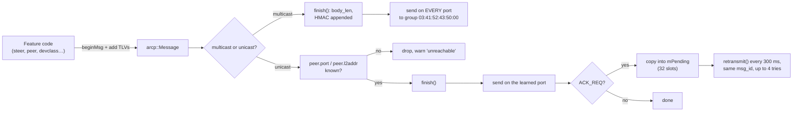
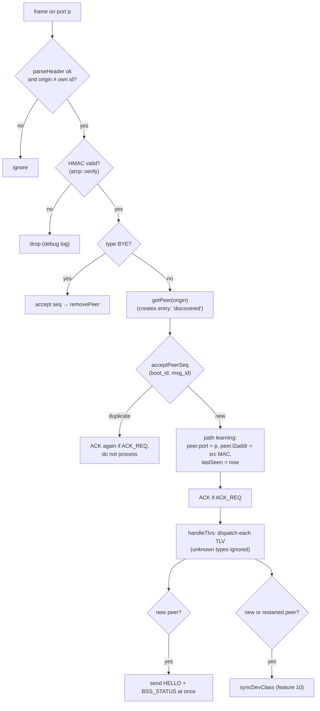
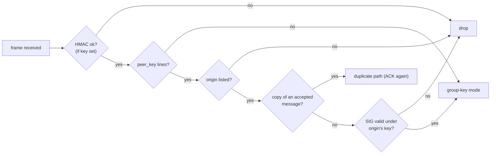
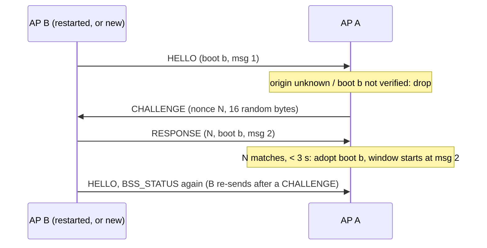
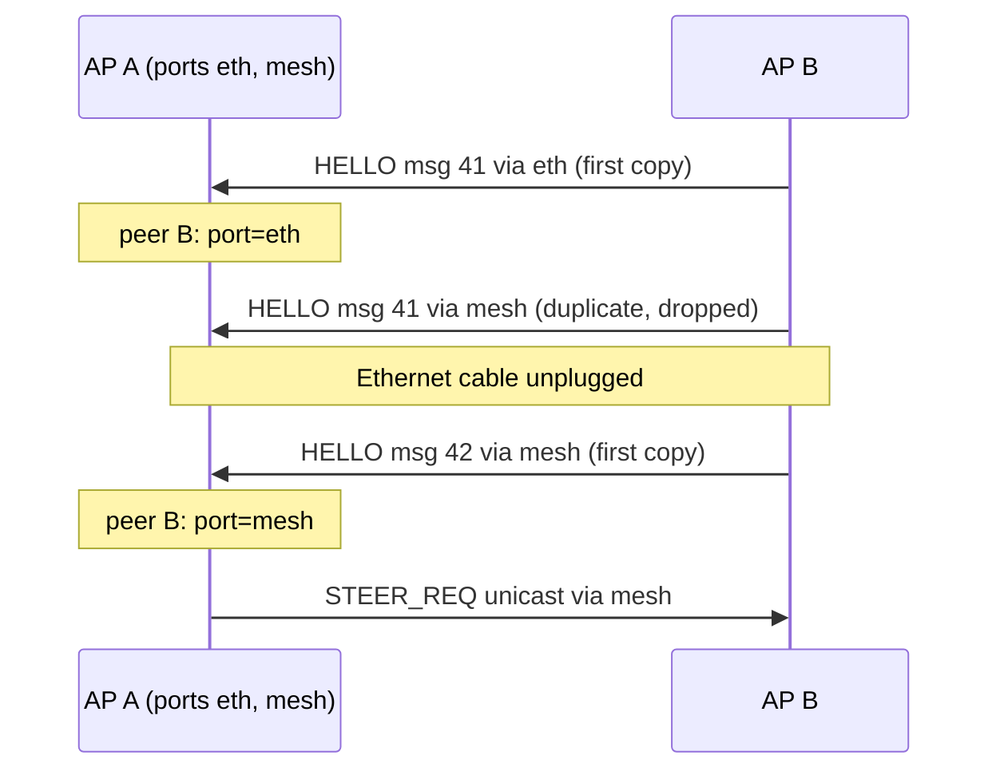

# 1. Transport and messaging

> **Source:** `src/l2.cpp`, `src/msg.cpp`, `src/peer.cpp` (`acceptPeerSeq`),
> `src/proto.{hpp,cpp}`, `src/sha256.cpp`, `src/sha512.cpp`, `src/ed25519.cpp` · **Spec:** [PROTOCOL.md](../PROTOCOL.md)
> §1–§5 · **Requirements:** FR-REL, FR-SEC, IR-8, IR-11

## What it does

Every coordination message between APs is an **ARCP** frame: a 24-byte header
plus TLVs, carried directly in Ethernet frames (no IP). This layer:

- sends and receives frames on one or more network ports (raw `AF_PACKET`
  sockets, or UDP on loopback in tests);
- authenticates every frame with a truncated HMAC-SHA256;
- drops replays and duplicates with a per-peer sliding window;
- makes selected messages reliable (acknowledged and retransmitted);
- learns, per peer, which port and MAC address reach it, and follows
  changes of backhaul automatically.

Why raw Ethernet: the APs of one ESS share a LAN, and a Layer-2 protocol
needs no IP configuration, works over any bridged backhaul (wired, WDS,
802.11s) and keeps the daemon small. IEEE 1905.1 was ruled out by
requirement.

## Frame layout

```
Ethernet II  | dst MAC | src MAC | 0x88B5 | ARCP header (24) | TLVs ... | AUTH TLV (19) |
ARCP header  | magic 0x4152 | ver 1 | type | flags | rsvd | msg_id u32 | boot_id u32 |
             | origin (AP id, 6) | body_len u16 | rsvd |
TLV          | type u8 | length u16 | value |
```

- `origin` is the AP id (the same whatever port the frame leaves on).
- `msg_id` grows by one per message; a retransmission reuses it.
- `boot_id` is random at start-up. A receiver adopts it only after the peer
  answers a CHALLENGE from that boot (liveness check below).
- `flags`: `0x01` ACK_REQ, `0x02` AUTH, `0x04` SIG.
- Maximum payload 1450 bytes, no fragmentation: long lists (STA entries,
  class records) are split over several messages.

## Data flow

### Sending



### Receiving



## Algorithms

All security options are off by default: `key` (HMAC), `liveness_check`,
`sign_seed` / `peer_key` (signatures) and `enroll` must be configured.

### Authentication (`proto.cpp` `finish` / `verify`)

```
key   = config "key hex:<64 hex>"
        or PBKDF2-HMAC-SHA256(passphrase, "donghoa-arcp-key", 100000 iterations)
AUTH  = HMAC-SHA256(key, header ‖ TLVs before AUTH)[0..15]
        (body_len already counts the 19-byte AUTH TLV)
SIG   = Ed25519(sign_seed, header ‖ TLVs before SIG)       optional, before AUTH
        (header final: body_len counts SIG and AUTH, flags SIG|AUTH set)
```

### Per-AP signatures (`ed25519.cpp`, `isSignatureOk`)



- Keys: `donghoa -g` prints a `sign_seed` line (this AP, secret) and a
  `peer_key <ap_id>` line (every AP). The daemon logs its own `peer_key`
  line at start-up (`signing as …`).
- Ed25519 is implemented in `ed25519.cpp` (radix 2^25.5 field, RFC 8032,
  pure Ed25519) with SHA-512 in `sha512.cpp`: no library. Signing uses a
  constant-time ladder over the secret scalar; verification, on public
  data only, walks both scalars in one doubling chain. Checked against the
  RFC 8032 vectors and, during development, 316 random cases against an
  independent implementation.
- Measured on x86-64: sign 0.45 ms, verify 0.39 ms (`-O2`); 0.75 / 0.62 ms
  at `-Os` (the OpenWrt default). An ARMv7 AP is roughly ten times slower.

A receiver **with** a key drops any frame without a valid AUTH TLV. A
receiver **without** a key drops any frame that has the AUTH flag. So a
mismatched configuration fails loudly (peers never appear) instead of
half-working.

### Replay window (`acceptPeerSeq`, as in IPsec)

Per peer: `bootId`, `seqHi` (highest `msg_id` seen), `seqWin` (64-bit mask,
bit *k* = `seqHi − k` seen).

```
if bootId is not the verified one:          # unknown origin, restart, or replay
    refuse (the receive path sends a CHALLENGE instead)
elif msgId > seqHi:                         # newer
    shift seqWin left by (msgId − seqHi), or clear it if ≥ 64; set bit 0
    seqHi = msgId; accept
else:                                        # older or equal
    k = seqHi − msgId
    accept only if k < 64 and bit k not set; then set bit k
```

The same window serves three purposes: replay protection, dropping the extra
copies when a frame arrives on several ports, and dropping retransmissions
whose first copy got through (those are ACKed again, because the first ACK
may be what was lost).

### Liveness check (`sendChallenge`, `answerChallenge`, `isResponseValid`)

Optional: `liveness_check 1` (off by default). With it off, a new `boot_id`
is adopted at once; CHALLENGEs are answered either way, so mixed settings
work together.



- A message of an unverified (origin, `boot_id`) is dropped and answered
  with a CHALLENGE to its Ethernet source; at most one per origin per
  500 ms, 8 outstanding. A BYE gets no CHALLENGE.
- A CHALLENGE is answered by anyone who gets it; the RESPONSE comes from
  the current boot and is useless to a replayer.
- A RESPONSE with a matching, unexpired nonce adopts its own `boot_id`
  (`arcp::resetSeq`): new peer, or `peer … restarted`.

Before this check, any different `boot_id` reset the window. An attacker who
recorded a peer across one restart could replay a frame of boot A, then
every recorded frame of boot B, and so on; and a removed peer could be
brought back with its recorded frames. Now a recorded frame can never adopt
a boot: it cannot answer a nonce it has never seen.

### Reliable unicast (`unicast`, `retransmit`, `onAckReceived`)

- A message with `FLAG_ACK_REQ` is sent once and copied into one of 32
  `mPending` slots.
- Every 300 ms (`RETX_INTERVAL_MS`) an unacknowledged copy is resent with
  the **same** `msg_id`, up to 4 tries (`RETX_MAX_TRIES`) in total.
- An ACK TLV naming `(peer, msg_id)` frees the slot.
- After the last try, or if the peer is gone, the slot is freed with a
  warning `… not acknowledged`.
- A full queue still sends the message once, without retransmission (warning
  `pending queue full`).

Used by: STEER_REQ/RESP/RESULT, STA_MONITOR_REPORT, STA_CLASS. Periodic
state (HELLO, BSS/STA/RF status, STA_EVENT) is multicast and simply repeated
by its timer; STA_MONITOR_REQ is multicast too, and a lost request ends at
the measurement timeout (feature 9).

### Path learning and backhaul failover

A node with several ports (e.g. `br-lan` and a mesh interface) multicasts on
**all** of them. For each **new** message (accepted by the replay window), the
port that delivered it and the Ethernet source address become that peer's
unicast path. If the wired link fails, the next HELLO arrives first over the
wireless path and unicast moves there by itself; when wired comes back and
is faster, it wins again.



### Sim transport (tests)

`sim_port <udp>` and `sim_peer <udp>` carry the same Ethernet frames inside
UDP datagrams on 127.0.0.1. The integration test runs several daemons on one
host without `CAP_NET_RAW`. Everything above `l2.cpp` is identical.

## Configuration

| Key | Default | Meaning |
|---|---|---|
| `iface <ifname>` | — | Port for ARCP (repeatable, up to 8), e.g. `br-lan` |
| `ap_id <mac>` | first port's MAC | AP identifier in `origin` |
| `key hex:<64 hex>` / `key <passphrase>` | none | HMAC key; must be identical on all APs |
| `sim_port`, `sim_peer` | — | UDP test transport (loopback) |

## Failure handling

| Situation | Behaviour |
|---|---|
| Wrong key on one AP | Its frames fail `verify`; it never becomes a peer (itest PASS 2, systest S13) |
| Frame truncated or bad magic/version | `parseHeader` rejects it |
| Unknown TLV type, longer known TLV | Skipped / extra bytes ignored (forward compatibility) |
| Peer restarts | Its new `boot_id` is verified by CHALLENGE / RESPONSE (one round trip), the window restarts; class records are re-sent |
| Recorded frame replayed (earlier boot, unseen boot, removed peer) | Refused: it cannot answer the CHALLENGE (itest PASS 22) |
| Box holding the group key but not in `peer_key` | Every message dropped, `origin not in peer_key` (itest PASS 23) |
| Message forged as another AP with the group key | Dropped: `bad or missing signature` (itest PASS 23) |
| `sign_seed` without `peer_key`, or own `peer_key` not matching the seed | Refused at start-up |
| Shipped example `key` left in place | Refused at start-up: `'key' is the public example value` |
| ACK lost | Retransmission arrives, is detected as duplicate, ACKed again, not reprocessed |

## Observability

- `donghoa_cli <sock> PEERS` shows each peer's port and age.
- `LOG debug msg` traces every frame: direction, type, peer, port, try.
- Warnings: `tx: peer … unreachable`, `… not acknowledged`, `pending queue full`.

## Tests

- Unit (`test_unit.cpp`): TLV round trips, header parsing, HMAC with known
  and PBKDF2 vectors, replay window (in order, out of order, duplicates,
  other boots refused, verified restart), CHALLENGE / RESPONSE TLVs, example
  key refused, passphrase derivation, overflow of a full message.
- Unit: SHA-512 vectors, RFC 8032 tests 1-3, rejected signatures (other
  key, changed R, S, message, S + L), invalid public key, SIG TLV with and
  without AUTH, `sign_seed` / `peer_key` parsing.
- itest PASS 1 (discovery, authenticated), PASS 2 (wrong key rejected),
  PASS 22 (restart verified in ~0.1 s; replayed BYE of the earlier and of an
  unseen boot refused; replayed HELLO after removal refused), PASS 23
  (signatures: unlisted box refused, forged BYE refused, bad configurations
  refused).
- systest S1, S13 (BYE and wrong key on real OpenWrt).

## Limitations

- Without `peer_key` the key is a group key: anyone holding it can forge any
  message. With signatures, a compromised AP can still speak as itself until
  its key is removed everywhere (by hand, or `ENROLL revoke` with automatic
  enrollment, feature 17).
- Each received message costs one signature verification (see above).
- EtherType `0x88B5` is the IEEE local-experimental value; a product should
  use an assigned one.
