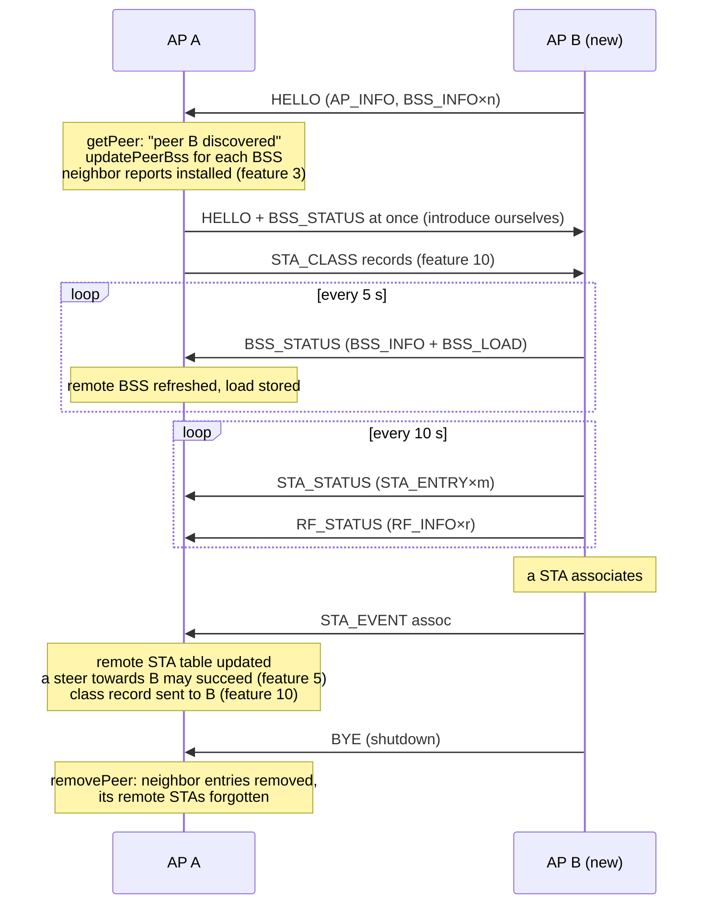

# 2. Peer discovery and state exchange

> **Source:** `src/msg.cpp` (`send*`, `handleTlvs`, `receiveMsg`),
> `src/peer.cpp` · **Spec:** [PROTOCOL.md](../PROTOCOL.md) §3–§4 ·
> **Requirements:** FR-DSC, FR-STE

## What it does

There is no controller and no configuration of neighbours: every AP
multicasts what it has, and every AP builds its own view of the network
from what it hears. Each AP keeps:

- a **peer table** (up to 32 peers): id, name, flags, learned path, last
  seen, replay window;
- per peer, its **BSSes** (up to 16) with their static info (BSS_INFO) and
  load (BSS_LOAD);
- per peer, its **radios** (up to 4, RF_INFO);
- a table of **remote STAs** (up to 512): which STA is on which peer's BSS.

This shared view is what the other features use: neighbor reports
(feature 3), candidate BSSes and their load (features 5–8), where a STA went
after a roam (feature 5), and who to ask for measurements (feature 9).

## Messages

| Message | Delivery | Content | When |
|---|---|---|---|
| HELLO | multicast | AP_INFO (name, flags, hello interval), BSS_INFO for each BSS that is up | every `hello_interval_ms` [2 s]; at once when a new peer appears |
| BSS_STATUS | multicast | BSS_INFO + BSS_LOAD per BSS (STA count, max STA, utilisation, noise, TX power, accepting flag) | every `bss_status_interval_ms` [5 s]; at once for a new peer |
| STA_STATUS | multicast | STA_ENTRY per local STA (BSS, RSSI, flags, rates, throughput, inactivity), split over several messages | every `sta_status_interval_ms` [10 s] |
| RF_STATUS | multicast | RF_INFO per operating channel | every `rf_status_interval_ms` [10 s] |
| STA_EVENT | multicast | STA, BSSID, assoc/disassoc | on each local association / disassociation |
| BYE | multicast | — | on clean shutdown |

## Data flow



## Algorithms

### Receiving state (`handleTlvs`)

| TLV | Effect |
|---|---|
| AP_INFO | peer name and flags (AIR_MONITOR) |
| BSS_INFO | `updatePeerBss`: new BSS → slot taken, logged; changed info → `nrInstalled = false` so the neighbor report is reinstalled; timestamp refreshed |
| BSS_LOAD | load of that remote BSS stored, `hasLoad = true` |
| STA_ENTRY | remote STA table: STA → (AP, BSSID, RSSI, flags) |
| RF_INFO | peer's radios (channel, width, utilisation, noise, TX power) |
| STA_EVENT assoc | remote STA updated; `onPeerStaAssoc` (class hand-over); `onStaEvent` (steering outcome, local copy marked `away`) |
| STA_EVENT disassoc | remote STA forgotten |

### Liveness (`expirePeers`, every tick)

```
for each peer:
    if now − lastSeen > peer_timeout_ms [7 s]:   removePeer   # missed ~3 HELLOs
    for each of its BSSes:
        if now − ts > 3 × bss_status_interval_ms + hello_interval_ms [17 s]:
            remove its neighbor report, drop the BSS
for each remote STA:
    if now − ts > 3 × sta_status_interval_ms [30 s]: drop it
```

`removePeer` (on timeout or BYE) removes every neighbor report of that peer
from the local hostapd, forgets its STAs, abandons a negotiation waiting on
it (the transaction moves to its next candidate) and frees reservations it
held.

### Restart detection

A peer's `boot_id` is random per start. A new `boot_id` from a known peer
(verified first by the liveness check when `liveness_check 1`, feature 1)
means it restarted: its
replay window is reset,
it is logged
(`peer … restarted`), and records it may have lost (device classes) are sent
again. A restart is noticed on its first frame, without waiting for the old
entry to time out (one CHALLENGE / RESPONSE round trip). A new origin is
added the same way, so replayed frames never create or revive a peer.

### Peer table full

The 33rd AP gets `peer table full, ignoring …` and is not tracked (no
neighbor entries, not a steering target). See the scale notes in feature 5.

## Configuration

| Key | Default | Meaning |
|---|---|---|
| `name` | `arcp-ap` | AP name in AP_INFO and logs (≤ 32 chars) |
| `hello_interval_ms` | 2000 | HELLO period |
| `bss_status_interval_ms` | 5000 | BSS_STATUS period |
| `sta_status_interval_ms` | 10000 | STA_STATUS period |
| `rf_status_interval_ms` | 10000 | RF_STATUS period |
| `peer_timeout_ms` | 7000 | Silence after which a peer is removed |

## Timing consequences

- A new AP is a usable peer within one HELLO (≤ 2 s); its load is known at
  once (BSS_STATUS is sent immediately to a new peer).
- A peer's load, as seen by others, is at most 5 s old. The target re-checks
  admission with its own fresh numbers (feature 8), so stale remote load
  never overloads a target.
- A crashed AP disappears after 7 s; a cleanly stopped one at once (BYE).

## Observability

- `PEERS`: each peer with name, port, age, its BSSes (channel, util, STA
  count) and radios.
- `STAS`: lines `remote <sta> ap=… bssid=…` for STAs seen on peers.
- Log: `peer … discovered`, `peer …: BSS … ch …`, `peer … restarted`,
  `peer … (name) lost`.

## Tests

- itest PASS 1: three daemons, two with the same key discover each other,
  exchange BSS and load (`util=` in `PEERS`).
- itest PASS 6: BYE removes the peer and its neighbor entries.
- itest PASS 12: 12 APs, each sees 11 peers.
- systest S1, S2, S13 on OpenWrt.
