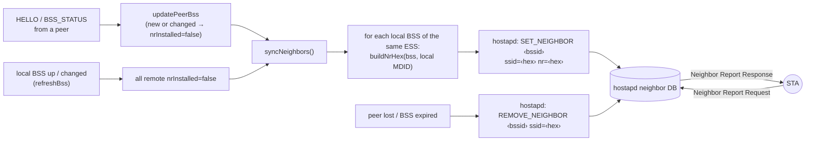

# 3. 802.11k neighbor reports

> **Source:** `src/local.cpp` (`syncNeighbors`, `setNeighbor`,
> `removeNeighbor`), `src/rrm.cpp` (`buildBssidInfo`, `buildNrHex`) ·
> **Requirements:** FR-NBR

## What it does

A STA that supports 802.11k can ask its AP for a **Neighbor Report**: the
list of nearby BSSes of the same network it could roam to. It uses the list
to scan only useful channels and to roam faster. hostapd answers these
requests from its **neighbor database**, which it does not fill by itself.

DongHoa keeps every local BSS's database complete and current:

- every **other local BSS** of the same ESS (e.g. the 5 GHz BSS in the
  2.4 GHz BSS's list);
- every **BSS of every peer** in the same ESS, as soon as it is advertised;
- entries are **removed** when the BSS or its peer goes away.

The same neighbor report element format is reused in the BTM request
candidate list (feature 5).

## Data flow



## Algorithm

### Which entries go where

```
syncNeighbors():
    for each pair (i, j), i ≠ j, both local BSSes up and same SSID:
        SET_NEIGHBOR on i for BSS j          # idempotent in hostapd
    for each peer, each remote BSS rb not yet installed:
        for each local BSS i up with the same SSID as rb:
            SET_NEIGHBOR on i for rb
        rb.nrInstalled = true
```

It runs when a peer BSS is new or changed (`nrInstalled == false`) and when a
local BSS comes up or its info changes (then every remote entry is marked
for reinstall, since the local MDID decides the MD bit).

### Neighbor Report element (13 bytes, 802.11 little-endian)

| Bytes | Field | Source |
|---|---|---|
| 0–5 | BSSID | BSS_INFO |
| 6–9 | BSSID Information | `buildBssidInfo` + per-receiver MD bit |
| 10 | Operating class | BSS_INFO |
| 11 | Channel | BSS_INFO |
| 12 | PHY type | BSS_INFO |

BSSID Information bits set by `buildBssidInfo(caps, secured)`:

| Bit | Set when |
|---|---|
| AP reachability (= reachable) | always |
| Security, Key scope | the BSS uses encryption (same key scope across the ESS) |
| Capabilities: QoS, Immediate Block Ack | always |
| Radio Measurement | the BSS advertises RRM (neighbor report or beacon report) |
| High Throughput / Very High Throughput / HE | from the BSS's capabilities |
| **Mobility Domain** | only if the neighbor's MDID equals **this** BSS's MDID (`buildNrHex`) |

The Mobility Domain bit tells the STA that 802.11r Fast Transition works to
that neighbour. It must be computed per receiving BSS: two BSSes may share a
neighbour but not a mobility domain. That is why the sender advertises its
MDID and each receiver sets the bit itself.

## hostapd requirements

- `rrm_neighbor_report=1` on each BSS (else `SET_NEIGHBOR` fails; DongHoa
  logs `SET_NEIGHBOR … failed (rrm_neighbor_report=1?)`).
- For FT: the same `mobility_domain` on all BSSes that should roam with FT.

## Failure handling

| Situation | Behaviour |
|---|---|
| hostapd rejects `SET_NEIGHBOR` | Warning, the rest continues |
| A peer stops advertising a BSS | Removed after 3×BSS status + HELLO [17 s] |
| A peer leaves (BYE or timeout) | All its entries removed at once |
| hostapd restarts (database empty) | BSS reconnect marks every entry for reinstall |

## Observability

```sh
ubus call hostapd.ap-5g rrm_nr_list     # on OpenWrt: the database contents
donghoa_cli <sock> LOG debug local      # SET_NEIGHBOR / REMOVE_NEIGHBOR commands
```

`rrm_log.cpp` decodes the `nr=` hex of each `SET_NEIGHBOR` at debug level, so
the log shows the BSSID Information bits in words.

## Tests

- Unit: `buildNrHex` byte layout and MD bit rule; `buildBssidInfo` bits.
- itest PASS 1: the mock hostapd parses `SET_NEIGHBOR`, both APs end up with
  each other's BSS, MD bit set; PASS 6: removed after BYE.
- systest S2: `rrm_nr_list` holds 3 entries per BSS (own sibling + 2 of the
  peer); S13: entries leave and return with the peer.
