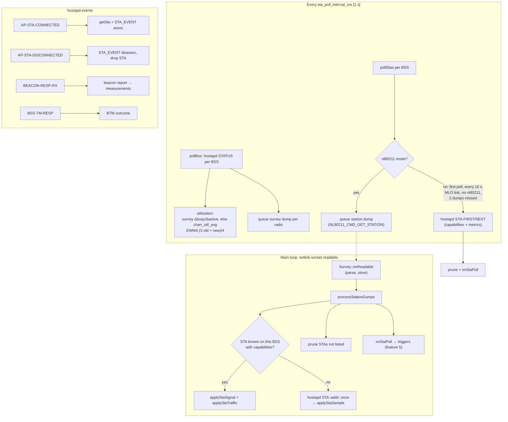

# 4. Local monitoring

> **Source:** `src/local.cpp`, `src/hapd.cpp`, `src/hapd_parse.cpp`,
> `src/survey.cpp`, `src/nlparse.cpp` · **Requirements:** FR-MON,
> NFR-PRF-4, IR-12 · **Design:** [SDD.md](../SDD.md) §6.4

## What it does

Each AP watches its own radios and clients so the decision code has fresh,
trustworthy numbers:

| Data | Source | Refresh |
|---|---|---|
| BSS status: BSSID, channel, op class, width, PHY caps, STA count, TX power | hostapd `STATUS` (+ `GET_CONFIG` once: security, FT AKM check) | every poll [1 s] |
| Channel utilisation (0–254) and noise | nl80211 survey (busy/active time), else hostapd `chan_util_avg` | every poll |
| Per-STA signal, inactivity, byte counters, rates | nl80211 **station dump** (asynchronous) | every poll |
| Per-STA capabilities: 11v (BTM), 11r (FT AKM), bands (Supported Operating Classes), AKM (6 GHz allowed?), PHY (VHT/HE/EHT), MLD links | hostapd `STA <addr>` / `STA-FIRST` / `STA-NEXT` | first sight, then every 10 s |
| Associations, disassociations, beacon reports, BTM responses | hostapd events (attached control socket) | immediately |

All requests are bounded: a hostapd command times out after 1 s, an nl80211
dump is never waited for and is abandoned after 1 s.

## Data flow



## Algorithms

### Channel utilisation

The kernel's survey for the radio's **in-use** channel gives cumulative
`active` and `busy` times (ms). Two consecutive dumps give:

```
util = 255 × (busy₂ − busy₁) / (active₂ − active₁)      # clamped to 0..254
        (−1 if the counters did not grow, e.g. a driver that clears on read)
load.util = (3 × load.util + util + 2) / 4               # EWMA, ~4 s time constant
```

- One survey dump per **radio** per poll, however many BSSes the radio has.
- A survey that is fresh but has no new dump keeps the last value; a survey
  older than 3 polls + 1 s is ignored.
- Without a usable survey (no nl80211, or no in-use channel, as with
  `mac80211_hwsim`), hostapd's `chan_util_avg` is used. `STATUS` shows which
  (`util_src=`).
- 255 on the wire means *unknown*; `policy::utilToPct` turns it into −1, and
  the policies treat unknown as free airtime.

### Per-STA metrics: station dump instead of per-STA hostapd requests

A hostapd `STA-NEXT` per STA is a blocking round trip inside the single event
loop. With 256 STAs that is 257 round trips per second, and a stalled hostapd
(during a `wifi` reload or DFS check) would freeze steering and ARCP. So each
poll queues one `NL80211_CMD_GET_STATION` dump per BSS on the same
non-blocking netlink socket as the survey, and the main loop processes it as
soon as it completes:

```
processStationDumps():
    for each BSS with a new dump generation (and in nl80211 mode):
        for each authorised station n in the dump:
            s = local STA n.addr
            if s unknown, on another BSS, or capabilities not read yet:
                hostapd "STA <addr>"  → applyStaSample (capabilities + metrics)
            else:
                applyStaSignal(s, n.signalAvg or n.signal, n.inactiveMs)
                applyStaTraffic(s, bytes, rates, inactivity)
        prune STAs of this BSS that were not listed
        onStaPoll for each listed STA        # steering triggers
```

Fallback to the full hostapd listing: first poll, every 10 s (capability
changes, missed events), AP MLD links, nl80211 unavailable, or two dumps in
a row that did not complete. Measured on QEMU: 6 hostapd STA round trips per
20 s instead of about 60, and ≤ 110 µs in the kernel per dump.

### Signal: only fresh samples count

hostapd's and the kernel's `signal` is the level of the STA's **last received
frame**. An idle STA keeps an old value. A sample therefore counts only when
the STA sent a frame within the last poll interval:

```
fresh = inactive_ms < sta_poll_interval_ms          # policy::isSignalFresh
if signal ≠ 0 and (first sample or fresh):
    rssi     = (3 × rssi + signal − 2) / 4          # EWMA
    lowCount = signal < rssi_low ? lowCount + 1 : 0
```

With the station dump, the kernel's per-frame average (`signal avg`) is used
where available.

### Throughput and traffic

```
tput_kbps = 8 × Δ(rx_bytes + tx_bytes) / Δt_ms
```

`rx_bytes` is uplink (STA → AP) and `tx_bytes` downlink; their per-poll
deltas also feed the low-power classifier (feature 10).

### STA table life cycle

- Created on `AP-STA-CONNECTED` or when first seen authorised in a listing;
  a new STA starts with a cooldown (`steer_cooldown_ms`) so it is not
  steered right after joining.
- Moved when it shows up on another local BSS (band steer): RSSI, low
  count and measurements are reset.
- Dropped on `AP-STA-DISCONNECTED`, when a listing no longer contains it
  (missed event), or when its BSS goes down. Its device class is saved
  first (feature 10).
- `away`: after a roam the old hostapd keeps the STA until its inactivity
  timer fires; once another AP reports the association, the local copy is
  marked `away` and is neither reported nor steered.

### Capability flags (FR-MON-3)

| Flag | Evidence | Without evidence |
|---|---|---|
| 11v | Extended Capabilities, BSS Transition bit | assumed with `assume_kvr` [1] |
| 11r | an FT AKM in `AKMSuiteSelector` | assumed with `assume_kvr` and an MDID on the BSS |
| 11k | none in hostapd output | assumed with `assume_kvr`, until hostapd refuses `REQ_BEACON` in every mode |

## Configuration

| Key | Default | Meaning |
|---|---|---|
| `bss <ifname> [mdid=…] [max_sta=…] [ft_over_ds=1]` | — | A hostapd BSS to manage (on OpenWrt generated from UCI, feature 13) |
| `hostapd_ctrl_dir` | `/var/run/hostapd` | hostapd control sockets |
| `sta_poll_interval_ms` | 1000 | Poll period |
| `assume_kvr` | 1 | Assume 11k/v/r until shown otherwise |

## Failure handling

| Situation | Behaviour |
|---|---|
| hostapd not running / socket gone | BSS marked down, its STAs dropped; reconnect every 5 s; neighbor entries reinstalled when back (systest S10) |
| hostapd command gets no reply in 1 s | Connection closed and reopened |
| Survey or station dump not answered in 1 s | Abandoned, socket reopened (`timeouts` in `STATUS`) |
| A dump slower than 20 ms in the driver | Warned once (slow firmware or bus) |
| More than 256 stations on an interface | List truncated, warned |

## Observability

```
donghoa_cli <sock> STATUS
  survey=nl80211 radios=2 dumps=660 last_us=17 max_us=190 timeouts=0 errors=0
  station_dump=nl80211 dumps=46 last_us=25 max_us=110
  ap-5g up
    … util=12% sta=1 …
    util_src=hostapd (chan_util_avg)
    sta_src=nl80211 station dump (hostapd resync every 10 s)
donghoa_cli <sock> STAS        # per STA: rssi, tput, flags=kvr, bands, class, backoff
```

## Tests

- Unit: hostapd `STATUS`/`STA` parsers (flags, op classes, AKM, MLD links),
  survey utilisation formula, `isSignalFresh`, station-dump parser on
  synthetic kernel messages (64-bit counters, rates, authorised flag,
  truncated input).
- itest PASS 3 (STA tracked with `flags=kvr`), PASS 13 (idle STA's stale
  signal ignored), mock hostapd for every parsed field.
- systest S3, S10 (hostapd restart), S11 (UCI interface rename), S16
  (station-dump path on real nl80211).
