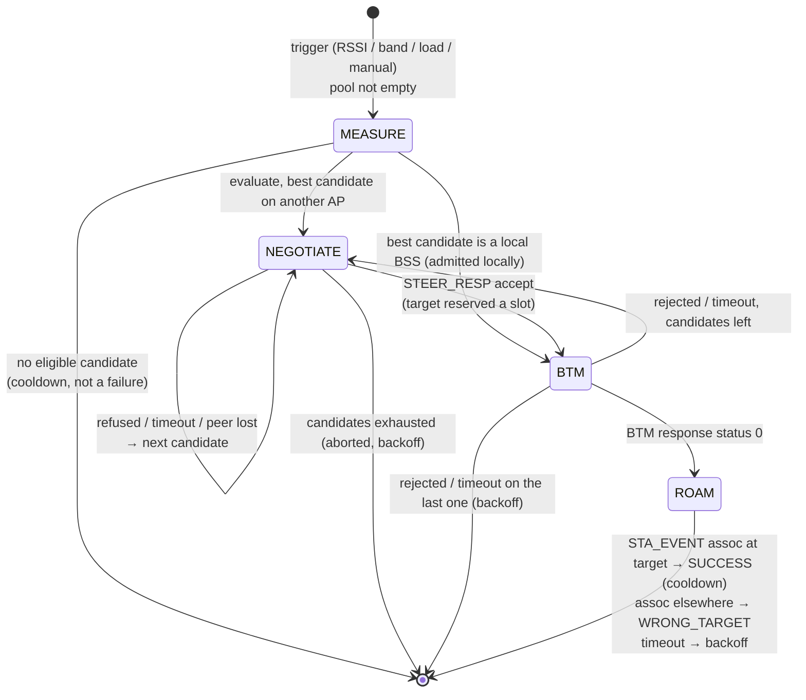
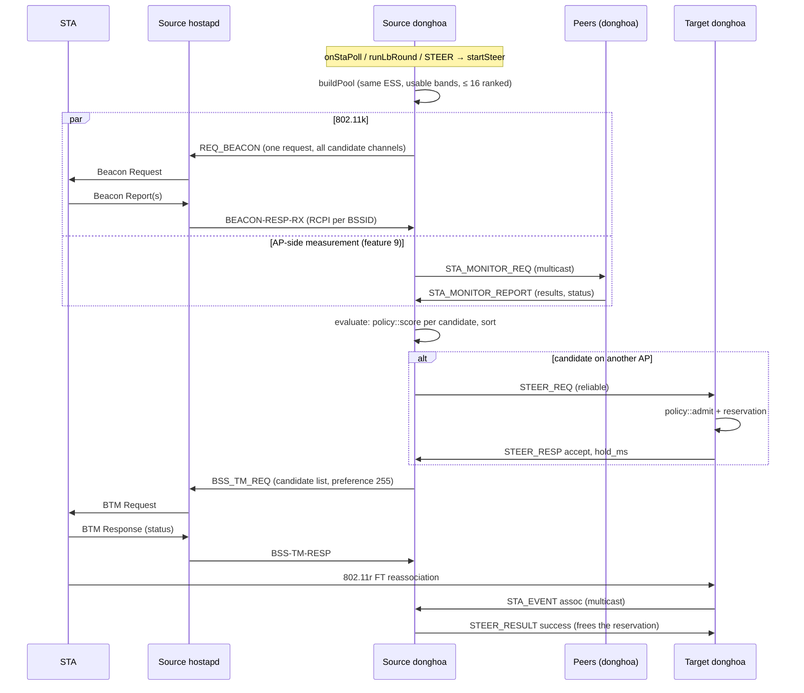

# 5. Steering engine

> **Source:** `src/steer.cpp`, `src/policy.cpp`, `src/rrm.cpp` (beacon
> request, reports) · **Requirements:** FR-TRG, FR-STR, FR-POL, FR-ADM ·
> **Design:** [SDD.md](../SDD.md) §6.5–6.6 · **Overview:**
> [STEERING.md](../STEERING.md)

## What it does

Every move of a STA, whatever the reason, runs through one engine. The AP
the STA is on (the **source**) opens one **transaction** per STA (at most 16
at a time) and drives it through four states:



The triggers are described in features 6 (RSSI), 7 (band), 8 (load); this
document is the shared machinery.

## Data flow



## Algorithm

### 1. Start (`startSteer`)

Refused when the STA already has a transaction, its BSS is down, or all 16
slots are busy. Otherwise the pool is built; an empty pool sets a cooldown
and ends (not a failure).

### 2. Candidate pool (`buildPool`)

```
candidates = every BSS, local (other than the STA's) or on any peer, with
    - the same SSID (ESS);
    - for a band steer, only higher bands;
    - with a forced target (manual), only that BSSID;
    - except for manual steers, only bands the STA can use (policy::isBandUsable):
        not blocked (6 GHz for a WPA2-PSK AKM) and advertised in its Supported
        Operating Classes, seen in use, or nothing advertised at all;
    - for an MLD STA, never another link of its own AP MLD (feature 11).
```

At most 16 (`MAX_CAND`). When more qualify (more than about 8 dual-band
APs), each gets a rank (`policy::candidatePoolRank`):

| Rank | Who |
|---|---|
| 2000 + RCPI | the STA was measured at this BSS in the last 2 min (11k or AP-side) |
| 1000 | a BSS of this AP (no negotiation needed) |
| 0 | any other BSS |

A BSS replaces the lowest-ranked entry only if it ranks strictly higher, so
unknown BSSes keep the peer order. That order starts, per STA, at
`poolStart`, which moves past the peers the previous pool held, so
successive steers of one STA cover every AP. The pool is sorted by rank so
the Beacon Request measures the most promising channels first.

### 3. Measure (802.11k part, `requestBeacons`)

- **One** Beacon Request for all distinct (op class, channel) pairs of the
  candidates, up to 8 (`MAX_BEACON_CHANNELS`): Channel 255 with AP Channel
  Report subelements when there are several. A STA refuses a second
  measurement while one runs, so one request is the only reliable way.
- Mode `beacon_mode` [active]; if hostapd refuses it (the STA did not
  advertise it in its RM Enabled Capabilities), active, then passive is
  tried. The first accepted mode is remembered per STA. If every mode is
  refused, the STA is marked as lacking 11k.
- Duration `beacon_duration` [50 TU] per channel; passive at least 120 TU.
- With `score_model 1` the serving channel is measured too (the throughput
  model needs the STA's own view of its current BSS).

### 4. When MEASURE ends

```
end MEASURE as soon as either:
    every candidate has an 11k report newer than the transaction start
    (and, with score_model 1, the serving BSS too);
  or no 11k report is pending any more (refused, or quiet: see below)
    and every AP asked for an AP-side measurement has answered
    (or every candidate has some level);
  or the deadline passes: max(beacon_req_timeout_ms [1500],
                              amon_duration_ms [1000] + 500) after the start.
```

**Quiet period.** A STA never reports a BSS it cannot hear, so "every
candidate reported" rarely happens when candidates sit on other APs. Each
report therefore sets a deadline `200 ms + 2 × measurement duration`
(302 ms active, 445 ms passive); when no further report has arrived by then,
the 11k part is over. Measured on QEMU: a band steer went from 1.78 s to
0.80 s.

Reports arriving outside a transaction are still cached (16 per STA, oldest
replaced) and used for 10 s (`MEAS_FRESH_MS`).

### 5. Evaluate and score (`evaluate`, `policy::score`)

Inputs per candidate:

| Input | Value |
|---|---|
| estimated RSSI | the STA's 11k report (≤ 10 s, `rcpi/2 − 110`), else an AP-side measurement (+ `amon_rssi_offset`), else unknown |
| unknown RSSI, manual steer | `rssi_min_target` (the operator decided) |
| unknown RSSI, RSSI steer, band advertised | floor `max(cur_rssi + rssi_hysteresis, rssi_min_target)`: a STA at the edge often never answers in time, but must not be stranded; a measured candidate always beats the floor |
| utilisation, STA count, max STA, accepting | own table for a local BSS, last BSS_LOAD for a remote one |
| peak PHY rate | from caps, width, `sta_nss` [2] (throughput model) |

**Hard gates** (both models): ineligible if the target is not accepting, its
RSSI is unknown, it is full (`sta_count ≥ max_sta`), its utilisation is
≥ `util_admit_max` [80 %], or RSSI < `rssi_min_target` [−70 dBm].

**Linear model** (`score_model 0`, default):

```
floor by reason:
    RSSI : cur_rssi + rssi_hysteresis [8 dB]
    LOAD : cur_rssi − lb_rssi_tolerance [5 dB];   ineligible if util > util_high − lb_margin
    BAND : rssi_min_target;                         ineligible unless band > current band
    MANUAL: rssi_min_target
eligible if est_rssi ≥ floor:
    score = est_rssi + band_bonus (5 GHz +5, 6 GHz +8) − util_weight [2] × util% / 10
```

Example: target heard at −60 dBm on 5 GHz with 30 % utilisation →
`−60 + 5 − 6 = −61`.

**Throughput model** (`score_model 1`):

```
quality(rssi) = 1000 / (1 + e^(−0.3 · (rssi − tput_rssi_mid [−72])))   # 61-entry table, 0..1000
peak          = top MCS rate × NSS for the PHY and width
                (HT 72/150, VHT 87/200/433/867, HE/EHT 143/287/601/1201/2402 Mbit/s per stream)
expected_kbps = quality × peak × (100 − util%) / 100
eligible by reason:
    RSSI, BAND : expected(target) ≥ tput_gain_pct [150 %] × expected(current)  (BAND: higher band)
    LOAD       : target util ≤ util_high − lb_margin and expected(target) ≥ expected(current)
score = expected(target)
```

Candidates are sorted best first (stable insertion sort); ineligible ones
are dropped. None left → "no suitable candidate": cooldown, and for a band
steer that measured nothing, a growing band backoff (feature 7).

### 6. Negotiate (`advance`, target side `onSteerReq`)

Walk the sorted list:

- **Local candidate:** `policy::admit` with the local load (and current
  reservations); accepted → BTM, else next.
- **Remote candidate:** STEER_REQ (reliable) with the STA, both BSSIDs,
  reason, the measured RCPI, STA flags and current RSSI. Deadline
  `steer_resp_timeout_ms` [1000] + 1500 ms (covers retransmissions).

Target side:

```
status = UNKNOWN_BSS   if the BSSID is not local
       = BUSY          if it is steering this STA itself
       = admit(util%, sta_count, reservations, max_sta):
             CAPACITY if sta_count + reserved ≥ max_sta
             LOAD     if util% ≥ util_admit_max
             ACCEPT   otherwise
on ACCEPT: take a reservation slot (32) for reserve_hold_ms [8 s], or BUSY if none
reply STEER_RESP (status, hold_ms)
```

Reservations count against capacity until the STA arrives (its STA_EVENT
consumes the slot), the source reports the result, the slot expires, or the
source AP is lost. They stop two sources from filling the same BSS at once.

### 7. BTM request (`sendBtm`)

```
BSS_TM_REQ <sta> pref=1 abridged=1 valid_int=<btm_valid_int [100 TBTT]>
           [disassoc_imminent=1 disassoc_timer=<n>]
           neighbor=<bssid>,0x<bssid_info>,<op_class>,<channel>,<phy_type>,0301ff
```

The candidate entry is a Neighbor Report element (feature 3) with
subelement 3 (BSS Transition Candidate Preference) = 255, and the Mobility
Domain bit when the target shares the source's MDID (FT possible).
`disassoc_imminent` is off by default: DongHoa asks, it does not force.
Deadline `btm_timeout_ms` [2000].

BTM response: status 0 → ROAM (deadline `roam_timeout_ms` [5000]). Any
other status (1 reject, 2 insufficient beacons, 3 capacity, 5 delay,
6 candidate list provided, 7 no candidates) → STEER_RESULT to that target
(frees its slot) and the next candidate, or the end.

### 8. Roam and outcome

The STA has roamed when **another AP reports its association** (STA_EVENT),
not when it says so. Outcomes and what follows:

| Outcome | Meaning | STA afterwards |
|---|---|---|
| SUCCESS | associated at the chosen target | `steer_cooldown_ms` [30 s], failures reset |
| WRONG_TARGET | associated at another BSS | cooldown, failures reset |
| BTM_REJECT / BTM_TIMEOUT / ROAM_TIMEOUT / ABORTED | did not move | backoff `cooldown × 2^failures`, capped at `steer_backoff_max_ms` [600 s] |
| no suitable candidate | nothing to move to | cooldown (not counted as a failure) |

An association back to the source BSS is ignored (some STAs reassociate
first).

### 9. The STA disconnects in the middle of a steer

| Phase when it drops | What happens | Penalty |
|---|---|---|
| MEASURE | aborted at once; late beacon reports and AP-side results are ignored | none (not a failure) |
| NEGOTIATE | aborted at once; **STEER_RESULT (aborted) to the target**, which frees its reservation; a late STEER_RESP is ignored | none |
| BTM, ROAM | kept: leaving is what a roaming STA does. Association at the target → SUCCESS, elsewhere → WRONG_TARGET, back at the source → ignored (new connection, start-up cooldown), nowhere → BTM timeout [2 s] / roam timeout [5 s], STEER_RESULT frees the target's slot | backoff only if it never reappears (and its entry still exists) |

On the target, a reservation always ends: the STA's association, a
STEER_RESULT (sent as soon as a STEER_REQ went out, aborted included, and
also when the target's answer never arrived: it may have accepted), the
source AP lost, or expiry after `reserve_hold_ms` [8 s] as the last resort.
The disconnect itself is multicast as STA_EVENT (disassoc), and the STA's
class and learned threshold are saved to its shared record.

Tested with fault injection (`DROPRX`, feature 12) in itest PASS 19: a lost
STEER_REQ is retransmitted; with every STEER_RESP lost, the NEGOTIATE timeout
releases the target's slot at once; a STA dropping in NEGOTIATE releases it
at once instead of after 8 s.

## Timing summary

| Phase | Typical | Bound |
|---|---|---|
| RSSI trigger | 3 polls of fresh low samples (~3 s) | — |
| MEASURE | 0.3–0.5 s after the reports (quiet period); 1 s when APs measure | 1.5 s |
| NEGOTIATE | one ARCP round trip | 2.5 s per candidate |
| BTM | STA dependent, ~100 ms | 2 s |
| ROAM (FT) | tens of ms | 5 s |
| Whole steer on QEMU | 0.4 s (local), 0.8 s (with a remote candidate) | — |

## Configuration

| Key | Default | Key | Default |
|---|---|---|---|
| `score_model` | 0 (linear) | `steer_cooldown_ms` | 30000 |
| `rssi_hysteresis` | 8 dB | `steer_backoff_max_ms` | 600000 |
| `rssi_min_target` | −70 dBm | `beacon_req_timeout_ms` | 1500 |
| `util_admit_max` | 80 % | `steer_resp_timeout_ms` | 1000 |
| `util_weight` | 2 | `btm_timeout_ms` | 2000 |
| `band_bonus_5g` / `_6g` | 5 / 8 | `roam_timeout_ms` | 5000 |
| `tput_rssi_mid` | −72 dBm | `reserve_hold_ms` | 8000 |
| `tput_gain_pct` | 150 % | `btm_valid_int` | 100 TBTT |
| `sta_nss` | 2 | `disassoc_imminent` | 0 |
| `beacon_mode` | active | `beacon_duration` | 50 TU |

## Observability

```
donghoa_cli <sock> STEERS            # running transactions, state, candidate, reservations
donghoa_cli <sock> STEER <sta> [<bssid>]
donghoa_cli <sock> LOG debug steer   # candidate scores
```

A steer in the log:

```
steer #4 aa:…:16 start: reason rssi, rssi -85, 4 candidate BSS
steer #4 aa:…:16: measurement requested, waiting for 1 AP(s)
steer #4: no more beacon reports for 302 ms, 11k measurement over
steer #4 cand 02:…:01:00 rssi -50 (air monitor) util 0% -> -47
steer #4 aa:…:16: asking AP 02:…:01 for 02:…:01:00
steer #4 aa:…:16: BTM request -> 02:…:01:00 ch 36 (score -47)
steer #4 aa:…:16 (rssi) finished: success after 1173 ms
```

## Tests

- Unit `test_policy`, `test_policy_tput`: gates, floors, both models, the
  sigmoid table, peak rates, admission, backoff, pool ranking.
- itest PASS 3 (cross-AP RSSI roam with passive reports), 4 (load), 5, 7, 8,
  9, 11, 12 (pool ranking with 12 APs), 13.
- systest S4–S8 (real 11k/11v/11r frames, both models), S6 (BTM reject,
  reservation released).
