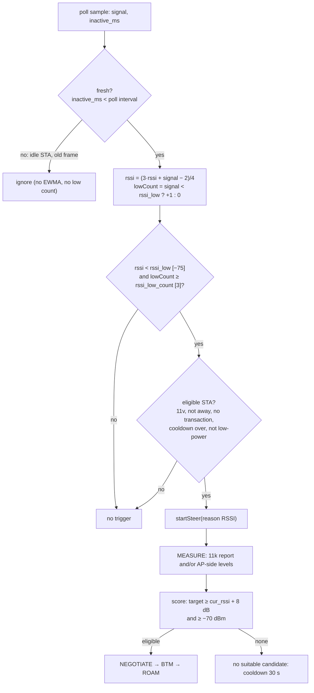

# 6. RSSI roaming

> **Source:** `src/steer.cpp` (`onStaPoll`), `src/local.cpp`
> (`applyStaSignal`), `src/policy.cpp` (`isRssiTriggered`,
> `isSignalFresh`, `score`) · **Requirements:** FR-TRG-1, FR-POL

## What it does

A STA that moves away from its AP keeps its association longer than is good
for it: most clients roam late, at a very low signal, after a period of poor
throughput. DongHoa notices the weak signal on the AP side, finds a BSS the
STA hears clearly better, and asks the STA to move there with a BTM request.
With 802.11r the move takes tens of milliseconds and the session continues.

## Data flow



## Algorithm

### Trigger

```
on each fresh sample of a non-MLD STA:
    rssi     = (3 × rssi + signal − 2) / 4
    lowCount = (signal < rssi_low) ? lowCount + 1 : 0

isRssiTriggered = rssi_steering
                  and rssi ≠ 0 and rssi < rssi_low          # smoothed level is low
                  and lowCount ≥ rssi_low_count              # and so were the last N raw samples

onStaPoll(s):
    skip if s.away, cooling down (nextSteerMs), no 11v, already steering,
            or low-power with lp_no_steer (feature 10)
    if RSSI trigger: startSteer(RSSI)
    elif band trigger: startSteer(BAND)                       # feature 7
```

Both conditions are needed: the EWMA filters a single bad sample; the
consecutive-sample count stops a slowly decaying average from firing late
after the signal has already recovered.

**Fresh samples only.** The signal hostapd and the kernel report is that of
the STA's last frame. An idle phone in a pocket that sent one weak frame
would otherwise count three times in three seconds and be steered on one
old value; a BTM request to a sleeping STA usually times out and costs it a
backoff. A sample counts only if `inactive_ms` < poll interval
(`policy::isSignalFresh`).

**MLD STA** (feature 11): each link keeps its own RSSI and low count; the
STA's RSSI is that of its best link and its low count the *minimum* over
links, so it counts as weak only when every link is.

### Choosing the target

The engine (feature 5) measures the candidates. For reason RSSI:

```
eligible if est_rssi ≥ cur_rssi + rssi_hysteresis [8 dB]
        and est_rssi ≥ rssi_min_target [−70 dBm]
        and the hard gates pass (accepting, not full, util < 80 %)
score   = est_rssi + band bonus − util_weight × util% / 10        # linear model
        = expected throughput, ≥ 150 % of the current one         # throughput model
```

The 8 dB hysteresis stops ping-pong between two APs that the STA hears
about equally.

**Unmeasured candidate.** A STA at the edge of coverage often does not
answer the Beacon Request in time. For an RSSI steer, a candidate on a band
the STA advertised gets the floor value `max(cur_rssi + 8, −70)` instead of
"unknown". It is just eligible, so any measured candidate beats it, but the
STA is not stranded on a failing link for lack of a report.

**STA without 802.11k.** The other APs measure the STA's own frames
(feature 9) and the engine uses those levels (plus `amon_rssi_offset`).

## Worked example (itest PASS 3)

| Step | Value |
|---|---|
| STA on AP1, signal | −82 dBm (three fresh samples < −75) |
| Trigger | RSSI, steer #1 |
| Beacon Request | passive (active refused by the STA) |
| Report | AP2's BSS at RCPI 110 → −55 dBm |
| Floor | −82 + 8 = −74 → −55 is eligible |
| Score (linear) | −55 + 5 (5 GHz) − 2 × 25/10 = −55 |
| Negotiate | STEER_REQ to AP2 → accept, slot reserved |
| BTM | AP2's BSS, preference 255, MD bit (same MDID) |
| Roam | STA_EVENT assoc from AP2 → success, STEER_RESULT frees the slot |

## Configuration

| Key | Default | Meaning |
|---|---|---|
| `rssi_steering` | 1 | Enable the trigger |
| `rssi_low` | −75 dBm | Smoothed RSSI below this is weak |
| `rssi_low_count` | 3 | Consecutive fresh low samples needed |
| `rssi_hysteresis` | 8 dB | Target must be this much better |
| `rssi_min_target` | −70 dBm | Never steer to a weaker target |
| `amon_rssi_offset` | 0 dB | Added to AP-side (uplink) levels |

## Tuning notes

- `rssi_low` higher (e.g. −70) roams earlier: better throughput, more
  steers. Lower values leave the STA longer on a weak AP.
- `rssi_low_count` × `sta_poll_interval_ms` is the minimum detection time.
- Raising `rssi_hysteresis` reduces ping-pong in overlapping coverage.

## Tests

- Unit `test_policy`: trigger and freshness rules, floors, the
  unmeasured-candidate floor.
- itest PASS 3 (cross-AP roam, passive mode fallback), PASS 5 and 11 (STA
  without 11k, measured by the other AP), PASS 9 (MLD STA roams only when
  all links are weak), PASS 13 (idle STA with a stale weak value is not
  steered; steered once it sends again).
- systest S6 (cross-AP negotiation and BTM reject on real hostapd).
