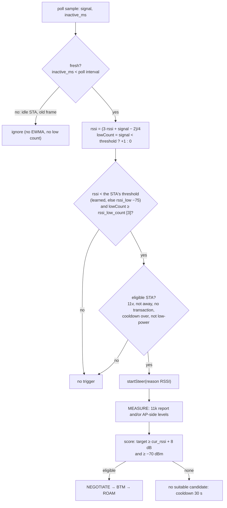
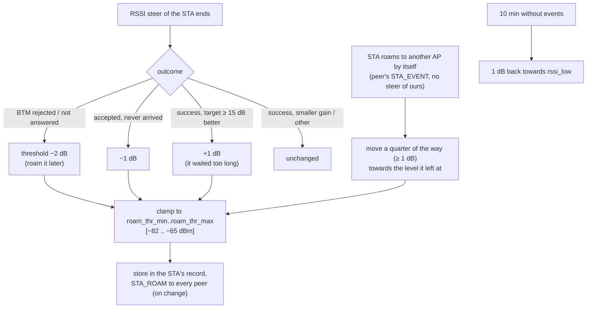

# 6. RSSI roaming

> **Source:** `src/steer.cpp` (`onStaPoll`), `src/local.cpp`
> (`applyStaSignal`), `src/policy.cpp` (`isRssiTriggered`,
> `isSignalFresh`, `score`) · **Requirements:** FR-TRG-1, FR-POL

## What it does

A STA that moves away from its AP keeps its association longer than is good
for it: most clients roam late, at a very low signal, after a period of poor
throughput. DongHoa notices the weak signal on the AP side, finds a BSS the
STA hears clearly better, and asks the STA to move there with a BTM request.
With 802.11r the move takes tens of milliseconds and the session continues.

## Data flow



## Algorithm

### Trigger

```
on each fresh sample of a non-MLD STA:
    rssi     = (3 × rssi + signal − 2) / 4
    lowCount = (signal < rssi_low) ? lowCount + 1 : 0

isRssiTriggered = rssi_steering
                  and rssi ≠ 0 and rssi < rssi_low          # smoothed level is low
                  and lowCount ≥ rssi_low_count              # and so were the last N raw samples

onStaPoll(s):
    skip if s.away, cooling down (nextSteerMs), no 11v, already steering,
            or low-power with lp_no_steer (feature 10)
    if RSSI trigger: startSteer(RSSI)
    elif band trigger: startSteer(BAND)                       # feature 7
```

Both conditions are needed: the EWMA filters a single bad sample; the
consecutive-sample count stops a slowly decaying average from firing late
after the signal has already recovered.

**Fresh samples only.** The signal hostapd and the kernel report is that of
the STA's last frame. An idle phone in a pocket that sent one weak frame
would otherwise count three times in three seconds and be steered on one
old value; a BTM request to a sleeping STA usually times out and costs it a
backoff. A sample counts only if `inactive_ms` < poll interval
(`policy::isSignalFresh`).

**MLD STA** (feature 11): each link keeps its own RSSI and low count; the
STA's RSSI is that of its best link and its low count the *minimum* over
links, so it counts as weak only when every link is.

### Per-STA roaming threshold

Clients differ: some cooperate with BTM and benefit from an early move,
others are "sticky" and refuse every request at −80 dBm. One global
`rssi_low` either pesters the sticky ones or moves the cooperative ones too
late. So each STA has its **own** threshold, learned from what happens when
DongHoa tries to move it, and from where it roams by itself.



```
threshold(s) = clamp(learned ≠ 0 ? learned : rssi_low,  roam_thr_min, roam_thr_max)
lowCount     counts fresh samples below threshold(s)
trigger      rssi < threshold(s) and lowCount ≥ rssi_low_count
```

- **Only RSSI steers teach.** Load and band steers, manual steers and "no
  suitable candidate" say nothing about the level at which this STA should
  roam.
- **Own roams.** If the STA leaves for another AP without a steer of ours,
  its last smoothed RSSI here is its natural roaming point. If it
  disassociated locally first (its entry is gone when the peer's report
  arrives), the level is kept in its record and used if the report comes
  within 5 s.
- **Sharing.** The threshold and an event counter travel with the STA in a
  STA_ROAM TLV, in the same reliable STA_CLASS messages as the low-power
  class (feature 10): sent to every peer on change, to the AP the STA
  associates to, and to new or restarted peers. A larger event count is the
  newer value.
- **Example (itest PASS 17).** A STA at −80 dBm refuses three BTM requests:
  −75 → −77 → −79 → −81 dBm. At −80 it is now above its own threshold and is
  left alone (with the global −75 it would be asked again after each
  backoff). AP2 holds the value. When the STA then roams to AP2 on its own,
  AP1 learns −81 → −80 and AP2's live entry takes it over.

## Learned decision (Q-learning)

Q-learning is off by default. With `rl_roam 2` (or `RL mode 2` at run time)
the decision *when* to steer comes from a learned Q-table instead of the
rule above; with `rl_roam 1` the table only learns from the rule's
decisions. See [feature 15](15-rl-roaming.md).

## Choosing the target

The engine (feature 5) measures the candidates. For reason RSSI:

```
eligible if est_rssi ≥ cur_rssi + rssi_hysteresis [8 dB]
        and est_rssi ≥ rssi_min_target [−70 dBm]
        and the hard gates pass (accepting, not full, util < 80 %)
score   = est_rssi + band bonus − util_weight × util% / 10        # linear model
        = expected throughput, ≥ 150 % of the current one         # throughput model
```

The 8 dB hysteresis stops ping-pong between two APs that the STA hears
about equally.

**Unmeasured candidate.** A STA at the edge of coverage often does not
answer the Beacon Request in time. For an RSSI steer, a candidate on a band
the STA advertised gets the floor value `max(cur_rssi + 8, −70)` instead of
"unknown". It is just eligible, so any measured candidate beats it, but the
STA is not stranded on a failing link for lack of a report.

**STA without 802.11k.** The other APs measure the STA's own frames
(feature 9) and the engine uses those levels (plus `amon_rssi_offset`).

## Worked example (itest PASS 3)

| Step | Value |
|---|---|
| STA on AP1, signal | −82 dBm (three fresh samples < −75) |
| Trigger | RSSI, steer #1 |
| Beacon Request | passive (active refused by the STA) |
| Report | AP2's BSS at RCPI 110 → −55 dBm |
| Floor | −82 + 8 = −74 → −55 is eligible |
| Score (linear) | −55 + 5 (5 GHz) − 2 × 25/10 = −55 |
| Negotiate | STEER_REQ to AP2 → accept, slot reserved |
| BTM | AP2's BSS, preference 255, MD bit (same MDID) |
| Roam | STA_EVENT assoc from AP2 → success, STEER_RESULT frees the slot |

## Configuration

| Key | Default | Meaning |
|---|---|---|
| `rssi_steering` | 1 | Enable the trigger |
| `rssi_low` | −75 dBm | Start value of every STA's threshold (and the value without learning) |
| `roam_thr_learn` | 1 | Learn a threshold per STA |
| `roam_thr_min` / `roam_thr_max` | −82 / −65 dBm | Range of a learned threshold |
| `rssi_low_count` | 3 | Consecutive fresh low samples needed |
| `rssi_hysteresis` | 8 dB | Target must be this much better |
| `rssi_min_target` | −70 dBm | Never steer to a weaker target |
| `amon_rssi_offset` | 0 dB | Added to AP-side (uplink) levels |

## Tuning notes

- `rssi_low` higher (e.g. −70) roams earlier: better throughput, more
  steers. Lower values leave the STA longer on a weak AP. With learning on,
  it is only the starting point: each STA moves within
  `roam_thr_min`..`roam_thr_max` from its own outcomes.
- `rssi_low_count` × `sta_poll_interval_ms` is the minimum detection time.
- Raising `rssi_hysteresis` reduces ping-pong in overlapping coverage.

## Tests

- Unit `test_policy`: trigger and freshness rules, floors, the
  unmeasured-candidate floor.
- itest PASS 17 (per-STA threshold: refusals lower it to −81, the STA is
  then left alone, the value reaches AP2, an own roam updates it, AP2's live
  entry follows; fails if the learned value is ignored).
- itest PASS 3 (cross-AP roam, passive mode fallback), PASS 5 and 11 (STA
  without 11k, measured by the other AP), PASS 9 (MLD STA roams only when
  all links are weak), PASS 13 (idle STA with a stale weak value is not
  steered; steered once it sends again).
- systest S6 (cross-AP negotiation and BTM reject on real hostapd).
