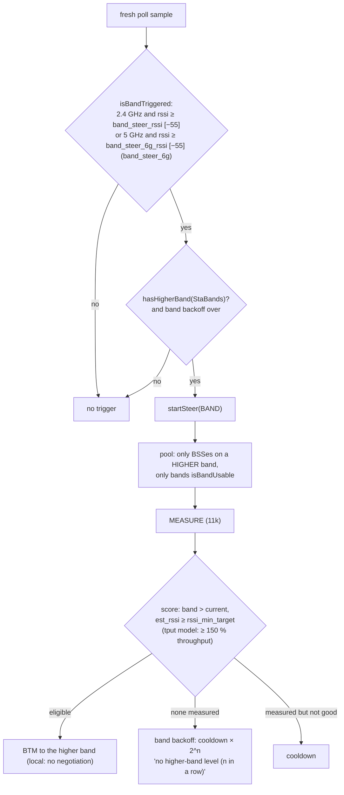

# 7. Band steering

> **Source:** `src/steer.cpp` (`onStaPoll`, `buildPool`,
> `failTxnNoCandidate`), `src/policy.cpp` (`isBandTriggered`,
> `isBandUsable`, `hasHigherBand`), `src/hapd_parse.cpp` (Supported
> Operating Classes, AKM) · **Requirements:** FR-TRG-2, FR-STR-2

## What it does

Dual- and tri-band clients often associate on 2.4 GHz, which has the longest
range but the least capacity and the most interference. When such a STA is
close to its AP (strong signal), DongHoa moves it to 5 GHz, or from 5 GHz to
6 GHz, on the same AP or on another one. The move uses the same engine as
every steer (feature 5), so it is measured, scored and negotiated.

Band steering never sends a STA to a band it cannot use:

- **Capability:** the bands the STA advertises in its Supported Operating
  Classes element (from its association request), or has been seen on.
- **Security:** 6 GHz requires WPA3/OWE; a STA associated with WPA2-PSK is
  never sent to 6 GHz.
- **MLO:** an MLD STA is not band-steered at all: its links already cover the
  bands, and link selection is the MLD's job (feature 11).

## Data flow



## Algorithm

### What the STA can use (`StaBands`)

| Field | Source |
|---|---|
| `advertised` | bands in `supp_op_classes` of hostapd's STA output (op classes mapped to 2.4/5/6 GHz) |
| `seen` | bands the STA has actually been associated on |
| `blocked` | 6 GHz when its AKM is not allowed there (WPA2-PSK, FT-PSK) |

```
isBandUsable(b, band):
    false if band is blocked
    true  if nothing advertised (old STA: no element, do not guess "no")
    true  if band is advertised or seen

hasHigherBand(b, current):
    from 2.4 GHz: 5 GHz or 6 GHz usable
    from 5 GHz  : 6 GHz advertised or seen, and not blocked
                  (stricter: "nothing advertised" is not enough for 6 GHz)
    from 6 GHz  : none
```

### Trigger

```
isBandTriggered = band_steering and rssi ≠ 0 and
                  ( (band == 2.4 GHz and rssi ≥ band_steer_rssi)
                 or (band_steer_6g and band == 5 GHz and rssi ≥ band_steer_6g_rssi) )

startSteer(BAND) if: trigger and not an MLD STA and now ≥ nextBandMs
                     and hasHigherBand
```

The RSSI trigger is checked first; a weak STA is never band-steered.

### Scoring

Linear model: eligible if the candidate's band is higher and its measured
RSSI is at least `rssi_min_target`; score includes the band bonus (5 GHz +5,
6 GHz +8). Throughput model: the higher band must promise at least
`tput_gain_pct` [150 %] of the current expected throughput. Two HT20 BSSes
on 2.4 and 5 GHz are equally fast, so the throughput model keeps the STA on
2.4 GHz (itest PASS 7, systest S7); a VHT80 5 GHz BSS is ~6× faster and wins
(PASS 8, S8).

### Band backoff

If a band steer finds no candidate **and measured nothing** (the STA did not
report the higher band at all), repeating it every 30 s wastes airtime:

```
bandEmpty += 1
nextBandMs = now + steer_cooldown_ms × 2^bandEmpty   (capped at steer_backoff_max_ms)
log: "no higher-band level (n in a row), next band steer in … ms"
```

The RSSI trigger is not affected by this backoff.

### Local versus remote

Most band steers are local: the AP's own 5 GHz BSS is the best candidate.
Then there is no negotiation; `policy::admit` runs on the local load, and the
BTM request goes out directly. A remote higher-band BSS is negotiated as
usual.

## Configuration

| Key | Default | Meaning |
|---|---|---|
| `band_steering` | 1 | Enable |
| `band_steer_rssi` | −55 dBm | 2.4 GHz STA at or above this moves up |
| `band_steer_6g` | 1 | Also move 5 GHz STAs to 6 GHz |
| `band_steer_6g_rssi` | −55 dBm | 5 GHz STA at or above this moves to 6 GHz |
| `band_bonus_5g` / `band_bonus_6g` | 5 / 8 | Linear-model score bonus |

## Tests

- Unit: `isBandUsable`, `hasHigherBand` with every combination, op-class →
  band mapping, AKM → 6 GHz block.
- itest PASS 7 (2.4-only STA skipped, dual-band steered, backoff when
  unmeasured), PASS 8 (6 GHz: WPA3 to 6, WPA2-PSK to 5 instead, 5 → 6, none
  without 6 GHz classes), PASS 9 (no band steer of an MLD STA).
- systest S5 (2.4 → 5 GHz with real reports, 0.8 s), S7/S8 (throughput model).
