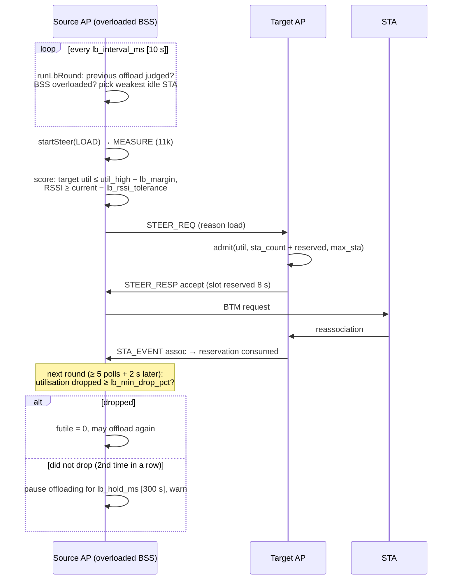

# 8. Load balancing

> **Source:** `src/steer.cpp` (`runLbRound`, `onSteerReq`, reservations),
> `src/policy.cpp` (`isBssOverloaded`, `isLbStaEligible`, `admit`,
> `isLbMoveEffective`) · **Requirements:** FR-TRG-3, FR-ADM

## What it does

When one BSS is overloaded (its channel is too busy, or it has reached its
STA limit) while a neighbouring BSS has room, DongHoa moves STAs from the
first to the second. Three mechanisms keep this safe:

1. **Admission control at the target:** a target only accepts a STA if its
   own, fresh load allows it.
2. **Reservations:** an accepted STA holds a slot until it arrives, so two
   sources cannot fill the same target at once.
3. **Feedback:** if moving STAs does not lower the overloaded BSS's
   utilisation, the BSS stops trying for a while instead of pushing out every
   idle STA.

## Data flow



## Algorithm

### Overload and choice (`runLbRound`)

```
every lb_interval_ms, for each local BSS b that is up and not paused:
    if b has an offload to judge (lbCheck):
        if its steer is still running, or the STA left < settle ago: skip b this round
        judge it (below)
    overloaded = load_balancing and
                 ( util% ≥ util_high [70]  or  (max_sta ≠ 0 and sta_count ≥ max_sta) )
    if not overloaded: futile = 0; continue
    pick = the eligible STA on b with the LOWEST rssi
           eligible: rssi known, cooldown over, 11v, no transaction,
                     not low-power with lp_no_steer,
                     and with lb_only_idle: tput < idle_kbps [50 kbit/s]
    if pick: startSteer(pick, LOAD); remember (STA, time, util%, by-util or by-count)
```

- **Weakest first:** a STA with a low signal uses a low rate, so it costs the
  most airtime per bit; moving it frees the most.
- **Idle only** (default): an active session is not interrupted for load
  reasons. With FT the move is fast, so `lb_only_idle 0` is reasonable too.
- **One STA per BSS per round** limits churn.

### Target selection (reason LOAD)

```
eligible if target util% ≤ util_high − lb_margin [70 − 15 = 55]
        and est_rssi ≥ cur_rssi − lb_rssi_tolerance [5 dB]   (linear)
        and expected throughput at target ≥ current           (throughput model)
plus the hard gates (accepting, not full, util < util_admit_max [80], ≥ −70 dBm)
```

The margin keeps a move from making the target the next overloaded BSS.

### Admission and reservations (target, `onSteerReq`)

```
admit(util%, sta_count, reserved, max_sta):
    CAPACITY  if max_sta ≠ 0 and sta_count + reserved ≥ max_sta
    LOAD      if util% ≥ util_admit_max [80]
    ACCEPT    otherwise
ACCEPT → reservation {sta, bss, txn, source AP, expiry = now + reserve_hold_ms [8 s]}
```

A reservation ends when the STA associates at the target (STA_EVENT), when
the source sends STEER_RESULT (any outcome), when it expires, or when the
source AP is lost. The BSS's `accepting` flag in BSS_LOAD tells other APs in
advance whether it would admit at all.

### Feedback (`policy::isLbMoveEffective`)

Utilisation measured as channel busy time includes the airtime of
**other networks and interference**, which no steering removes, and idle
STAs (the default choice) use little airtime anyway. Without feedback a busy
BSS would push out one idle STA every 10 s, forever, with no relief.

```
settle = 5 × sta_poll_interval_ms + 2 s      # utilisation EWMA follows, roam done

judge an offload when its steer is over and (STA gone and now ≥ start + settle):
    if the STA did not leave (steer failed): no judgement
    elif it was triggered by utilisation:
        effective = util_now ≤ util_before − lb_min_drop_pct [3]   (unknown util: effective)
        if effective: futile = 0
        else:
            futile += 1; log "offloading … did not lower utilisation (a% -> b%), n in a row"
            if futile ≥ lb_max_futile [2]:
                pause the BSS until now + lb_hold_ms [300 s]
                warn "load balancing paused …: moving STAs does not lower utilisation
                      (airtime of other networks or interference?)"
```

Overload by STA count is exempt: one STA leaving always fixes the count.

**Moved, or just gone?** An offload is judged only when the STA was seen
associated elsewhere: on another local BSS, marked away by a peer's
STA_EVENT, or present in the remote STA table. A STA that simply
disconnected says nothing about whether offloading helps: it gets no
verdict (`… disconnected instead of moving: no verdict on the offload`), so
a disconnect never counts towards the futile moves that pause the BSS
(itest PASS 20).

## Reaction time

| Delay | Typical |
|---|---|
| Utilisation EWMA catching up | ~4 polls (4 s) |
| Next balancing round | ≤ `lb_interval_ms` (10 s) |
| Peers' view of this BSS's load | ≤ `bss_status_interval_ms` (5 s) old; the target re-checks with fresh data |
| Draining several STAs | one per round per BSS |

## Configuration

| Key | Default | Meaning |
|---|---|---|
| `load_balancing` | 1 | Enable |
| `util_high` | 70 % | Overload threshold |
| `util_admit_max` | 80 % | Target refuses steer-in at or above |
| `lb_margin` | 15 % | Target must be below `util_high − lb_margin` |
| `lb_rssi_tolerance` | 5 dB | Signal the STA may lose |
| `lb_only_idle` / `idle_kbps` | 1 / 50 | Only move STAs below this throughput |
| `lb_interval_ms` | 10000 | Round period |
| `lb_min_drop_pct` | 3 | Utilisation drop an offload must achieve |
| `lb_max_futile` | 2 | Futile offloads in a row before pausing |
| `lb_hold_ms` | 300000 | Pause length |
| `reserve_hold_ms` | 8000 | Reservation lifetime |
| `max_sta=` on a `bss` line | hostapd `max_num_sta` | STA limit used for overload and admission |

## Observability

- `STATUS` / `PEERS`: utilisation, STA count, accepting flag per BSS.
- `STEERS`: reservations (`reservation sta … bss=… txn=…`).
- Log: `bss … overloaded (util 87%, 5 STA): offloading …`,
  `steer-in request #… : accept|reject`, the feedback lines above.

## Tests

- Unit: `isBssOverloaded`, `isLbStaEligible`, `admit` (capacity counts
  reservations), `isLbMoveEffective`, new keys.
- itest PASS 4 (busy AP2 offloads its idle STA to AP1, `reason load`),
  PASS 14 (utilisation never drops: exactly 2 offloads, then a pause; the
  third idle STA stays; fails without the rule).
- systest S6 (reservation taken and released on BTM reject).
