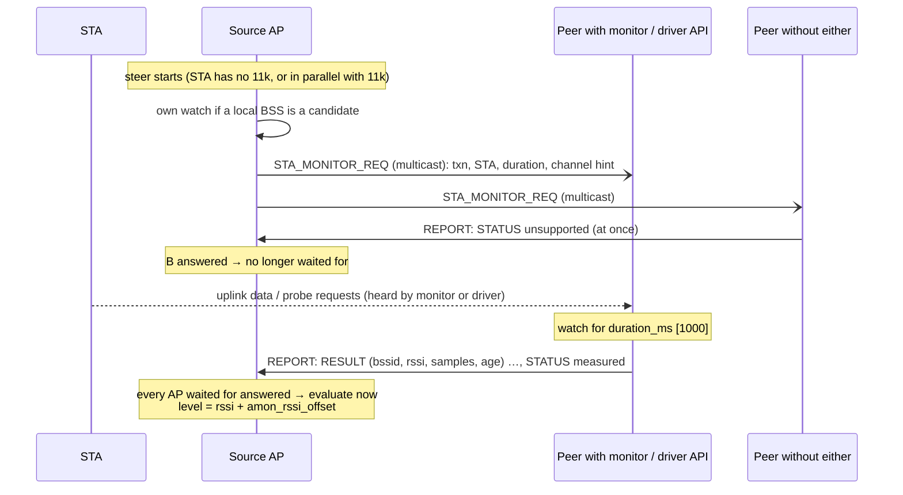
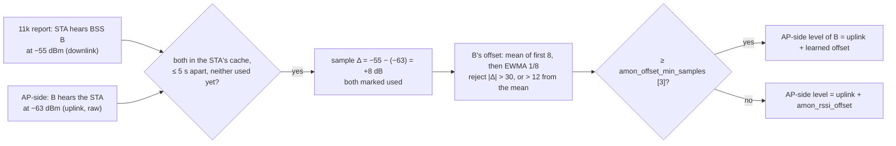

# 9. AP-side measurement (STAs without 802.11k)

> **Source:** `src/amon.cpp`, `src/vendor_rssi.{hpp,cpp}`, `src/rrm.cpp`
> (`parseRadiotap`), `src/steer.cpp` (`requestMonitors`), `src/os.cpp`
> (`openMonitor`, BPF) · **Spec:** [PROTOCOL.md](../PROTOCOL.md) §7 ·
> **Requirements:** FR-AMN, IR-13

## What it does

Steering needs to know how well the STA would hear each candidate. A STA
with 802.11k answers a Beacon Request. A STA **without** 802.11k (or one too
busy to answer) cannot, so the APs measure the reverse direction: the RSSI
of the STA's own frames, as each AP's radio hears them. The exchange has
four steps:

1. The source AP multicasts a request with the STA's MAC address.
2. Every AP measures the STA with whatever it has: a radiotap **monitor
   interface**, and/or the Wi-Fi driver's **per-STA RSSI API** (vendor
   specific; a placeholder until the chipset documentation is available).
3. Every AP **always answers**, including "I cannot measure", so the source
   knows who has answered.
4. The source evaluates as soon as every AP it waits for has answered, or at
   the timeout, and picks the target.

## Data flow



## Algorithm

### Source side (`requestMonitors`, `onAmonStatus`)

```
monWait = []
for each candidate (deduplicated by AP):
    local candidate: start own watch; if started, wait for self
    remote candidate on a known peer: wait for that peer
if any remote candidate: multicast STA_MONITOR_REQ (no ACK_REQ)
deadline = max(current deadline, now + amon_duration_ms + 500 ms)

on STA_MONITOR_RESULT: store as AIR_MONITOR level of that BSS (rssi + amon_rssi_offset)
on STA_MONITOR_STATUS from X (always logged):
    remove X from monWait
    if monWait empty: amonPending = false;
        evaluate now unless an 802.11k report is still pending
at the deadline: log every AP still in monWait ("no measurement answer"),
                 evaluate with what arrived
```

Every peer gets the request (they all measure; results for non-candidate
BSSes are kept too), but only peers owning a candidate are waited for. The
STA's own 802.11k report of a BSS always wins over an AP-side level.

### Measuring side (`onAmonReq`, `startAmonWatch`, `finishAmonWatch`)

```
startAmonWatch(sta, requester, txn, duration, op class, channel):
    no monitor and sta_rssi_api off        → UNSUPPORTED
    16 watches running                      → BUSY
    sta_rssi_api: for each BSS that is up and isStaRssiSupported:
        startStaRssi(ifname, sta, …) → OK: remember the BSS in the driver mask
                                     → FAILED: note it, stopStaRssi
    no monitor and no BSS started          → FAILED or UNSUPPORTED
    else start the watch until now + duration          → MEASURED (= started)
if not started: answer at once with the status only

while watching, each radiotap frame whose TA is the STA:
    add its dBm to the watch's accumulator for the frame's frequency (≤ 4)

finishAmonWatch (time up):
    for each local BSS that is up:
        driver mask has the BSS: readStaRssi → that value; stopStaRssi
        else a monitor accumulator on the BSS's frequency: average dBm
        → STA_MONITOR_RESULT {bssid, rssi, samples, age_ms}
    status = MEASURED if any result, FAILED if only driver errors, else NOT_HEARD
    one STA_MONITOR_REPORT (reliable): results first, status last
```

Results go before the status in the same report, because the source
evaluates on the status.

### Radiotap path (`openMonitor`, `parseRadiotap`)

- `AF_PACKET` socket on a monitor interface with a classic BPF filter: only
  probe requests and data frames with ToDS set and FromDS clear (uplink,
  power-save nulls included). Beacons, ACKs and downlink stay in the kernel.
- `parseRadiotap` (pure) walks the present bitmaps (extended words too),
  aligns each field, rejects bad-FCS frames and frames without a signal,
  and returns transmitter address, frequency and dBm.
- A stock radio hears only its own channel: uplink data of STAs on that
  channel, and probe requests when a STA scans.

### Driver per-STA RSSI API (`vendor_rssi.hpp`)

```cpp
bool       isStaRssiSupported(std::string_view ifname);
RssiStatus startStaRssi(ifname, const Mac &sta, opClass, channel, durationMs); // returns at once
RssiStatus readStaRssi(ifname, const Mac &sta, RssiSample &out);              // once, at the watch end
void       stopStaRssi(ifname, const Mac &sta);
```

The four vendor bodies are placeholders marked `TODO(vendor)` that report
*unsupported*. The file header lists the rules for filling them in: no
blocking (start returns at once, read is called once); system calls go into
`os.cpp`; "no sample" maps to NOT_HEARD and errors to FAILED; report the
average dBm of the STA's own frames. `sta_rssi_sim <file>` selects a
simulated driver for tests: lines `<ifname> <sta> <dBm>`, `unsupported`,
`fail`; the file is re-read on each call.

### Uplink → downlink calibration (`pairUlDl`, `policy::addUlDlSample`)

An AP-side level is **uplink**: how the BSS's radio hears the STA. Steering
needs **downlink**: how the STA would hear the BSS. They differ by the TX
power and antenna asymmetry between AP and STA, typically several dB. One
global `amon_rssi_offset` cannot fit every AP, so DongHoa learns the offset
per BSS from STAs that are measured both ways.



```
sample:      Δ = downlink_dBm − uplink_dBm              (11k RCPI/2 − 110, raw AP-side RSSI)
accept:      |Δ| ≤ 30, and once calibrated |Δ − mean| ≤ 12
update:      mean16 += (16·Δ − mean16) / min(n + 1, 8)   (×16 fixed point)
use:         downlink = uplink + round(mean16 / 16)      if n ≥ amon_offset_min_samples
```

- Pairs come for free: every steer of an 802.11k STA runs the Beacon Request
  and the AP-side measurement in parallel. Reports outside a steer count too.
- Each measurement is used once: a burst of reports against one AP-side
  result is a single sample.
- The table holds 64 BSSes; the least recently updated is replaced.
- `CALIB` lists them:

```
default amon_rssi_offset=0 learn=1 min_samples=3
calib 02:00:00:00:02:00 offset=+8.0dB samples=3 used=yes age=4s
```

Log: `ul/dl sample <bssid> sta …: downlink -55 uplink -63 -> 8 dB, offset +8.0 (3 samples)`
(debug) and `<bssid>: uplink/downlink offset learned: +8.0 dB (3 samples)` (info).

### Answer statuses

| Status | Sent | Meaning |
|---|---|---|
| 0 measured | after the watch | results precede it |
| 1 not heard | after the watch | no frame of the STA |
| 2 unsupported | at once | no monitor and no driver API |
| 3 busy | at once | watch table full |
| 4 failed | at once / after | driver API error |

## Configuration

| Key | Default | Meaning |
|---|---|---|
| `air_monitor <ifname>` | — | Monitor interface (repeatable, ≤ 4); create with `iw phy <phy> interface add mon1 type monitor` |
| `amon_request` | 1 | Ask the APs during MEASURE |
| `amon_duration_ms` | 1000 | Watch time (≤ 5000) |
| `amon_rssi_offset` | 0 dB | Uplink → downlink correction until a BSS's offset is learned |
| `amon_offset_learn` | 1 | Learn the offset per BSS (below) |
| `amon_offset_min_samples` | 3 | Samples before a learned offset is used |
| `sta_rssi_api` | 0 | Use the driver per-STA RSSI API |
| `air_monitor_sim`, `sta_rssi_sim` | — | Test inputs (radiotap over UDP; simulated driver file) |

## Observability

- `MONITOR <sta> [<ms>]`: start a local watch; the result appears in the log
  (`… heard by <bssid> (AP …): -58 dBm, 12 samples`), or `FAIL unsupported`.
- Log: `… asks to measure …`, `<sta>: AP … unsupported|measured|not heard`,
  `every AP asked has answered`, `no measurement answer from AP …`.
- `PEERS`: AIR_MONITOR flag (informational; every AP answers).

## Tests

- Unit: radiotap alignment and extended bitmaps, frame filter rules,
  STA_MONITOR_REQ/RESULT/STATUS round trips, forward-compatible decode.
- itest PASS 16 (offset learning: three pairs at +8 dB, then a STA without
  11k heard at −70 dBm is scored at −62 dBm; fails if the offset is ignored).
- itest PASS 5 (monitor path, injected radiotap frames), PASS 11 (driver API:
  "unsupported" answered at once and evaluated early; then measured −50 dBm
  and steered).
- systest S9 (real monitor interface: radiotap RSSI equals the station
  table), S14 (exchange on real hostapd: unsupported in ≤ 1 ms, then −61 dBm
  from the simulated driver).

## Limitations

- The vendor API is a placeholder: on real hardware every AP answers
  *unsupported* unless it has a monitor interface.
- One learned offset per BSS: STAs with very different TX power share it.
- Offsets are learned on the AP that saw both measurements, not shared.
- A monitor hears a busy STA only on its own channel.
