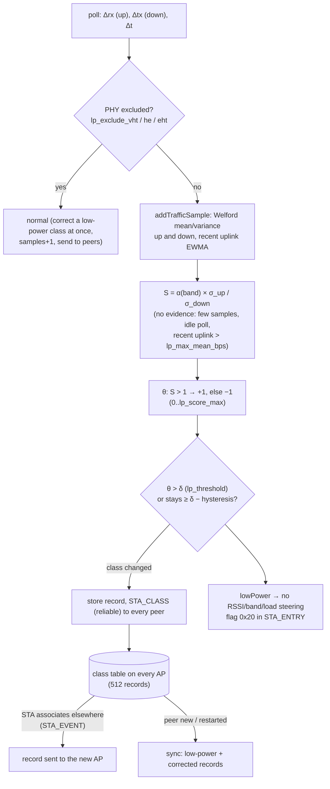
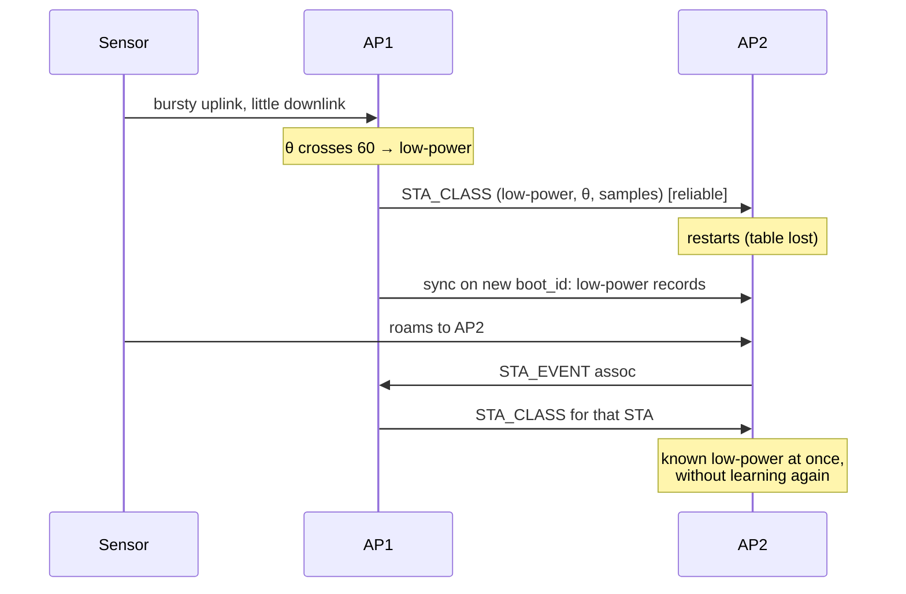

# 10. Low-power device classification

> **Source:** `src/devclass.cpp`, `src/policy.cpp` (`addTrafficSample`,
> `lpBehaviourScore`, `updateLpScore`, `isLowPower`, `isLpExcludedPhy`) ·
> **Spec:** [PROTOCOL.md](../PROTOCOL.md) §8 · **Requirements:** FR-LPC-1..6

## What it does

IoT devices (sensors, battery cameras, smart plugs) behave differently from
phones and laptops: they wake up, push a burst of data **up**, receive almost
nothing, and sleep. Steering them is pointless and risky (they often ignore
BTM requests, and a missed wake-up costs battery). DongHoa:

1. recognises them from their **traffic shape**, per STA, on the AP;
2. shares the class with every other AP, so it follows the device when it
   roams and survives an AP restart;
3. keeps low-power devices out of automatic steering (`lp_no_steer`).

The method follows the paper *"Phương pháp phân loại thiết bị kết nối không
dây công suất thấp trong mạng WiFi Mesh"*, adapted: there is no master AP,
the score is bounded, the class has hysteresis, and idle polls are no
evidence.

## Data flow



## Algorithm

### Statistics per STA (`addTrafficSample`)

Per poll, uplink rate `u` and downlink rate `d` in bytes/s (clamped to 2²⁵).
Integer Welford update per direction, mean kept ×16 so a sensor's few bytes
per second do not truncate to zero:

```
n += 1
delta = 16·x − mean16
mean16 += delta / n
m2 += delta · (16·x − mean16) / 256          # sum of squared deviations
past 1024 samples: n and m2 are halved      # variance kept, long memory
upRecent16 = n == 1 ? 16·u : upRecent16 + (16·u − upRecent16) / 8   # ~8-poll average
lastActive = (u > 0 or d > 0)
```

### Behaviour score S (`lpBehaviourScore`)

```
σ_u / σ_d = √m2_up / √m2_down                 # n cancels
S×100     = α(band) × √m2_up / √m2_down       # α = lp_alpha_2g/5g/6g [100] / 100
no evidence (θ unchanged) when:
    n < lp_min_samples [10]
    the latest poll moved no data (idle STA)
    recent uplink average > lp_max_mean_bps [20000 B/s]   # a real upload, not a sensor
    neither direction varies
S = ∞ (capped 1 000 000) when only the uplink varies
```

Why each rule:

- **Idle polls:** without it, one old uplink burst (σ_u > 0) and no downlink
  at all (σ_d = 0) scored S = ∞ on *every* idle poll; an idle phone turned
  low-power within a minute (found on the QEMU testbed).
- **Recent-rate gate:** a phone uploading photos has exactly the sensor's
  shape (bursty up, quiet down) at 1000× the volume. The gate uses an
  ~8-poll average, so it reopens a few polls after the upload ends.

### Score θ and class (`updateLpScore`, `isLowPower`)

```
θ = clamp(θ + (S > 1 ? +1 : −1), 0, lp_score_max [120])     # unchanged without evidence
low-power  when θ > lp_threshold δ [60]
normal     again only when θ < δ − lp_hysteresis [50]
```

A sensor reaches the class after about `lp_min_samples + δ` active polls.

### PHY exclusion (`isLpExcludedPhy`)

A STA that negotiated a PHY ruled out by `lp_exclude_vht` [1],
`lp_exclude_he` [0] or `lp_exclude_eht` [1] (from hostapd's
`flags=[VHT][HE][EHT]`) is never low-power. HE is allowed by default because
Wi-Fi 6 IoT chips use it for Target Wake Time. A STA already classified
low-power is corrected at once, with its sample count raised by one so peers
accept the correction (records are versioned by sample count).

### Sharing between APs (no master)

Each AP keeps up to 512 records `{STA, class, θ, samples, source AP, time,
corrected}`; a full table replaces its oldest record. `samples` only grows
along one STA's history, so it is the record's version: a record replaces
another only with **strictly more** samples.

| Event | Action |
|---|---|
| Local STA's class changes | store, STA_CLASS (reliable) to every peer |
| STA associates on another AP (STA_EVENT) | the record, if any, goes to that AP |
| Local STA entry created | restore θ, class, samples from the table |
| Local STA entry dropped | save into the table |
| STA_CLASS received | table; a live local STA takes it over if it carries more samples |
| New or restarted peer | sync: every low-power record and every record corrected from low-power to normal (`corrected`); plain normal records are not sent |



## Configuration

| Key | Default | Meaning |
|---|---|---|
| `lp_classify` | 1 | Classify local STAs |
| `lp_no_steer` | 1 | No automatic RSSI/band/load steering of low-power STAs (manual still works) |
| `lp_threshold` / `lp_hysteresis` | 60 / 10 | δ and the hysteresis |
| `lp_score_max` | 120 | θ bound |
| `lp_min_samples` | 10 | Samples before S counts |
| `lp_max_mean_bps` | 20000 | Recent uplink rate above which S is no evidence (0: off) |
| `lp_alpha_2g` / `_5g` / `_6g` | 100 | α × 100 per band |
| `lp_exclude_vht` / `_he` / `_eht` | 1 / 0 / 1 | PHYs that rule out low-power |

## Observability

```
donghoa_cli <sock> STAS       # … class=low-power lp_score=61/60 s=inf …
donghoa_cli <sock> DEVCLASS   # devclass <sta> class=… score=… samples=… from=<AP> age=…s
donghoa_cli <sock> LOG debug class   # per-poll rates, means, sigmas, S, θ
```

Log: `sta … classified low-power (score 61/60, S inf, 70 samples)`,
`sta … classified normal (its PHY overrides the traffic shape)`.

## Tests

- Unit `testLowPower`: Welford against known variances, window halving, S per
  band, θ clamping and hysteresis, sensor vs phone vs big upload traces, gate
  recovery, idle-STA regression, PHY exclusion, STA_CLASS round trip.
- itest PASS 10: sensor classified, phone not, VHT phone not, HE-only sensor
  classified; class reaches AP2, survives AP2's restart, follows a roam;
  corrections synced; not steered.
- systest S15: on real hostapd counters the idle STA stays normal,
  uplink-only ARP traffic makes it low-power, AP2 learns the class.

## Limitations

- Thresholds and α are not calibrated on real IoT devices (SDD R16).
- A streaming camera exceeds the default rate gate and is not classified.
- A class that is already wrong stays wrong while the STA is idle; it clears
  with real traffic, or when every AP is stopped at the same time.
