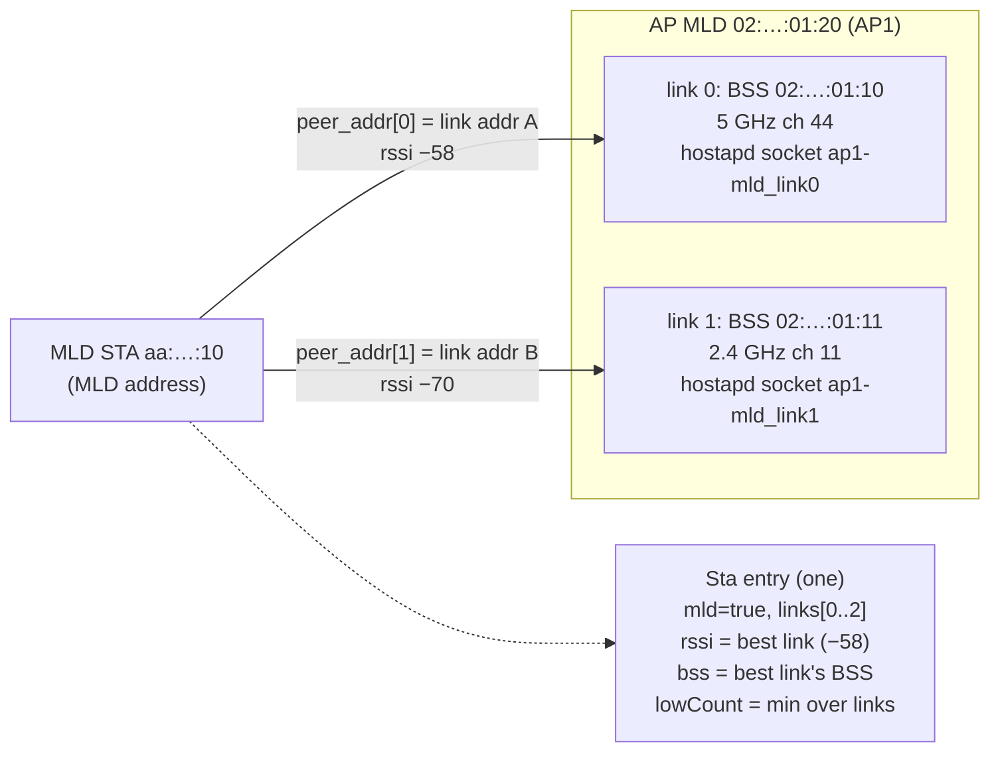

# 11. Wi-Fi 7 MLO awareness

> **Source:** `src/local.cpp` (`updateStaLink`, `aggregateLinks`,
> `pruneStaLinks`, `getSta`), `src/hapd_parse.cpp` (MLD fields),
> `src/proto.{hpp,cpp}` (BSS_INFO trailer, `isSameMld`), `src/steer.cpp`
> (`buildPool`, `onStaEvent`) · **Spec:** [PROTOCOL.md](../PROTOCOL.md) §3
> (BSS_INFO) · **Requirements:** FR-MLO

## What it does

With Wi-Fi 7 Multi-Link Operation, one **AP MLD** has several affiliated
BSSes ("links"), e.g. 5 GHz and 6 GHz, and one **MLD STA** can be connected
on several links at once under one MLD address. DongHoa treats both as one
device:

- an AP MLD's links are advertised with their MLD address and link ID, so
  every AP knows which BSSes belong together;
- an MLD STA is **one** entry, not one per link; its signal is its best
  link's;
- it is never steered from one link to another of the same AP MLD (link
  selection is the MLD's own job), and never band-steered;
- it is RSSI-steered only when **every** link is weak;
- a roam succeeds when it associates through **any** link of the target AP
  MLD.

## Data model



## Algorithm

### Advertising AP MLD links

hostapd exposes each link through its own control socket named
`<netdev>_link<id>`; `hapd::netdevName` maps it back to the MLD netdev (for
the ifindex). hostapd `STATUS` gives the MLD address and link ID, which are
appended to BSS_INFO as an optional trailer (`mld_addr`, `link_id`). Older
receivers ignore the trailer; a BSS without it is not part of an AP MLD.
`arcp::isSameMld(a, b)` is true when both carry the same non-zero MLD
address.

### One entry per MLD STA

hostapd lists an MLD STA on each link socket, under its MLD address, with
`peer_addr[<link id>]=<link address>` lines and `max_simul_links`.

```
updateStaLink(s, sample, bss):
    find or add the link for this BSS (≤ 3 links)
    if a fresh signal: link.rssi = EWMA; link.lowCount = low ? +1 : 0
    aggregateLinks(s)

aggregateLinks(s):
    best = link with the highest rssi
    s.rssi = best.rssi;  s.bss = best.bss
    s.lowCount = MIN(link.lowCount)            # weak only when every link is weak

pruneStaLinks(s, bss): drop links on this BSS not seen in the listing;
                       the STA goes when no link is left
```

- Traffic counters come from one link only (the first one seen), or the
  deltas would mix two sources.
- `getSta` does not treat the STA showing up on another link of the same AP
  MLD as a move between BSSes.
- BSSes that are AP MLD links keep the hostapd listing every poll (the
  station-dump path in feature 4 is used for other BSSes).

### Steering rules

| Rule | Where |
|---|---|
| No band steer of an MLD STA | `onStaPoll` checks `!s.mld` before the band trigger |
| Never a candidate on another link of the STA's own AP MLD | `buildPool` (`ownMld`) |
| RSSI trigger only when all links are weak | `lowCount` = minimum over links |
| Success if the STA associates via any link of the chosen AP MLD | `onStaEvent` with `isSameMld` |
| Reassociation via any link of the source AP MLD is "back home", ignored | `onStaEvent` |

A legacy (non-MLD) STA may still be steered between the affiliated BSSes of
one AP MLD; for it only the exact BSSID counts.

## Observability

- `STATUS`: per BSS `mld=<addr> link=<id>`.
- `STAS`: an MLD STA line lists its links with their RSSI.
- `PEERS`: peers' BSSes with their MLD trailer.

## Tests

- Unit `testMlo`: BSS_INFO trailer round trip and old-format decode,
  `isSameMld`, hostapd `peer_addr[…]` parsing, link socket name → netdev.
- itest PASS 9: one entry per MLD STA, no band steer onto its own link,
  roam only when all links are weak, success through any link of the target.

## Limitations

- Tested against the mock hostapd only; the field formats of real hostapd
  MLO builds are listed under "Assumptions to verify" in
  [ARCHITECTURE.md](../ARCHITECTURE.md).
- No TID-to-link mapping or per-link steering: link management stays with
  the MLD.
