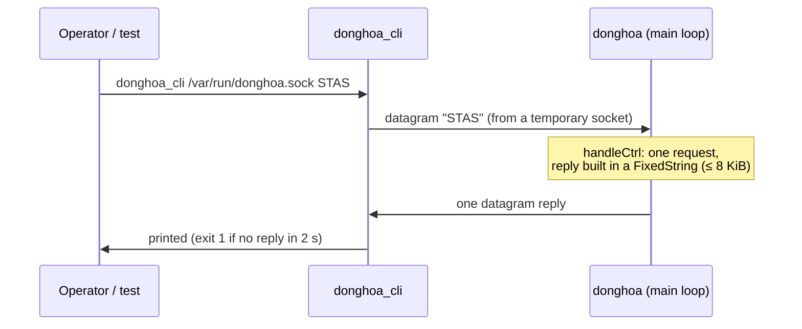
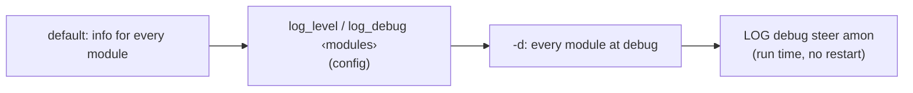

# 12. Control interface and logging

> **Source:** `src/ctrl.cpp`, `tools/donghoa_cli.cpp`, `src/log.{hpp,cpp}`,
> `src/rrm_log.cpp`, `src/metrics.{hpp,cpp}` · **Requirements:** IR-3, IR-4, IR-5, FR-OBS-1

## What it does

- A **control socket** (UNIX datagram, `ctrl_socket`) lets operators and
  tests query the daemon's state and give commands, without a restart.
- **`donghoa_cli`** sends one request and prints the reply.
- **Per-module logging** with run-time levels, to stderr or syslog, with an
  optional decoded trace of every ARCP frame and 802.11 element.
- **Outcome counters** (`METRICS`): what steering, load balancing and ARCP
  did since start-up, in the Prometheus text format, so the effect of a
  configuration change can be measured instead of guessed.

## Data flow



The control socket is one more descriptor in the `poll()` loop; a request is
answered in the same loop iteration, so the reply is a consistent snapshot.

## Commands

| Command | Reply |
|---|---|
| `PING` | `PONG` |
| `STATUS` | AP id, name, boot id, ports, air monitors, `survey=` and `station_dump=` statistics, each BSS: up/down, BSSID, channel, width, caps, MLD, load, `util_src=`, `sta_src=` |
| `PEERS` | each peer: name, port, age, its BSSes (channel, util, STA count, MLD) and radios |
| `STAS` | each local STA: BSS, RSSI, throughput, `flags=kvr`, beacon mode, bands (advertised, seen, 6 GHz block), class and `lp_score`, `roam_thr` (learned or default) and `roam_events`, backoff; MLD links; then `remote` STAs on peers |
| `STEERS` | running transactions (state, candidate i/n) and reservations |
| `DEVCLASS` | device class records: class, score, samples, source AP, age, and a learned `roam_thr` / `roam_events` |
| `CALIB` | learned uplink → downlink offsets per BSS (feature 9) |
| `BANDIT [mode <0|1|2> \| reset]` | contextual bandit for the target choice: mode, counters, learned mean per visited context; switch mode or clear (feature 16) |
| `DROPRX [<MESSAGE> <n>]` | fault injection: drop the next *n* received ARCP messages of that type (e.g. `STEER_RESP`) before ACK and processing, as a lossy link would; logged on every drop; `DROPRX` shows what is pending, `n = 0` cancels. For tests and diagnosis |
| `RL [mode <0|1|2> \| reset]` | Q-learning of when to roam: mode, counters, learned values per visited state; switch mode or reset to the prior (feature 15) |
| `STEER <sta> [<bssid>]` | start a manual steer (clears the STA's cooldown), optionally to one BSS |
| `MONITOR <sta> [<ms>]` | measure a STA with this AP's monitors / driver API; result in the log |
| `METRICS` | outcome counters and gauges, Prometheus text format (below) |
| `CHECK` | configuration findings against the peers: 802.11r / security of BSS pairs, steering settings (feature 18) |
| `LOG` | each module's level |
| `LOG <level> [<module>…]` | set the level (`err`, `warning`, `notice`, `info`, `debug`, or the RFC 5424 number 3–7) of all or some modules |

Unknown commands get `UNKNOWN COMMAND`; bad arguments get `FAIL <usage>`.

## Logging

### Format

```
<monotonic seconds.ms> [<TAG>] <module>: <message>
382192.699 [INF] steer: steer #2 aa:…:17: BTM request -> 02:…:47:00 ch 36 (score -51)
```

Tags `ERR`, `WRN`, `NTC`, `INF`, `DBG`. Modules: `main`, `l2`, `msg`, `peer`,
`hapd`, `local`, `steer`, `policy`, `amon`, `survey`, `ctrl`, `config`,
`rrm`, `class`, `enroll`, `check`. The monotonic time matches `time.monotonic()`, so test
markers and logs of several APs can be merged by time.

### Levels

The levels are the RFC 5424 (syslog) severities, with their numbers. With
`-s` each line goes to syslog with exactly that priority, so `logread`,
remote syslog servers and log filters see standard severities.

| Level (number) | Tag | Used for | Examples |
|---|---|---|---|
| `err` (3) | `ERR` | the daemon cannot do something it should | socket or config failure, key file not writable |
| `warning` (4) | `WRN` | something is wrong but handled | message not acknowledged, hostapd rejected a BTM request, a setting differs from a peer's |
| `notice` (5) | `NTC` | normal but significant events | start / stop, peer discovered / lost / restarted, BSS up, hostapd connected, steer finished (with outcome), device class change, enrollment requests and decisions, findings cleared |
| `info` (6) | `INF` | routine operation | each step of a steer, STA association, measurements, offload decisions, records learned from peers |
| `debug` (7) | `DBG` | traces | ARCP frames, hostapd commands, per-poll values |

The default is `info`. `log_level notice` keeps only the significant
events, which suits the small `logread` buffer of a router. Names and
numbers are both accepted: `warn` and `error` are aliases, `emerg`,
`alert`, `crit` and 0–2 set `err` (the daemon has nothing more severe).



- Each file that logs declares its module
  (`constexpr LogModule LOG_MODULE{LogModule::STEER};`); the tag is added
  automatically, messages do not repeat it.
- Output to stderr, or with `-s` to syslog (facility daemon) with matching
  priorities. On OpenWrt the service uses `-s`; read with `logread -e donghoa`.

### Debug traces

| Module at debug | Shows |
|---|---|
| `msg` | every ARCP frame: direction, type, peer, port, try number |
| `hapd` | every hostapd command and event |
| `rrm` | decoded `SET_NEIGHBOR` (BSSID Information in words), `REQ_BEACON` (mode, channels, duration), `BSS_TM_REQ` (candidates, preference, MD bit), beacon reports |
| `steer` | candidate scores and the end of each MEASURE part |
| `class` | per-poll traffic rates, means, sigmas, S and θ |
| `survey` | time each nl80211 dump spent in the driver |

## Metrics

`METRICS` answers in the Prometheus text exposition format. To feed
node_exporter's textfile collector, for example from cron:

```sh
donghoa_cli /var/run/donghoa.sock METRICS > /tmp/node_exporter/donghoa.prom.$$ &&
  mv /tmp/node_exporter/donghoa.prom.$$ /tmp/node_exporter/donghoa.prom
```

Counters start at zero with the daemon and only grow. A series with value 0
is left out, so the reply fits one 8 KiB control datagram; it appears with
its first event. Labels: `bss` (the local interface), `reason` (`rssi`,
`load`, `band`, `manual`), `result`, `status`.

| Series | Kind | Meaning |
|---|---|---|
| `donghoa_uptime_seconds`, `donghoa_peers`, `donghoa_steer_active` | gauge | |
| `donghoa_config_issues` | gauge | consistency findings (feature 18) |
| `donghoa_bss_up`, `donghoa_bss_stations`, `donghoa_bss_util_pct` | gauge | per local BSS |
| `donghoa_steer_started_total{bss,reason}` | counter | transactions started from this BSS |
| `donghoa_steer_no_pool_total{bss,reason}` | counter | trigger fired, no BSS to measure at all |
| `donghoa_steer_total{bss,reason,result}` | counter | how they ended: `success`, `btm_reject`, `btm_timeout`, `roam_timeout`, `wrong_target`, `aborted`, `no_candidate` |
| `donghoa_btm_sent_total`, `donghoa_btm_accept_total`, `donghoa_btm_reject_total` `{bss,reason}` | counter | BTM requests and the STA's answers (each rejection counts, also when the next candidate is tried) |
| `donghoa_steer_gain_db_sum` / `_count` `{bss,reason}` | counter | target level − level when the steer started, over successes with a known level: the average gain is sum / count |
| `donghoa_steer_duration_ms_sum{bss,reason}` | counter | start to association, successes: average = sum / `steer_total{result="success"}` |
| `donghoa_steer_in_total{bss,status}` | counter | STEER_REQ answered as target: `accept`, `capacity`, `load`, `busy`, … |
| `donghoa_steer_in_success_total`, `donghoa_steer_in_failed_total` `{bss}` | counter | outcomes the source reported for accepted steer-ins |
| `donghoa_lb_offload_total`, `_effective_total`, `_futile_total`, `_no_verdict_total`, `_pause_total` `{bss}` | counter | load-balancing offloads and their feedback verdicts (feature 8) |
| `donghoa_arcp_rx_total`, `donghoa_arcp_tx_total` | counter | messages processed / sent |
| `donghoa_arcp_drop_total{reason}` | counter | received and dropped: `bad_header`, `auth`, `signature`, `untrusted`, `unverified_boot`, `duplicate` |
| `donghoa_arcp_retransmit_total`, `_ack_timeout_total`, `_queue_full_total` | counter | reliable unicast |

Useful ratios: steering success rate = `steer_total{result="success"}` /
`steer_started_total`; BTM acceptance = `btm_accept_total` /
`btm_sent_total`; a growing `arcp_drop_total{reason="auth"}` means an AP
with the wrong key.

## Configuration

| Key | Default | Meaning |
|---|---|---|
| `ctrl_socket` | none (OpenWrt: `/var/run/donghoa.sock`) | Control socket path |
| `log_level` | info | Level of every module: `err`, `warning`, `notice`, `info`, `debug` or 3–7 |
| `log_debug <m1>,<m2> …` | — | Modules at debug |
| command line `-d` / `-s` / `-c <file>` | — | all debug / syslog / config file |

## Tests

- Unit `testLog`: level parsing, per-module masks, formatting.
- Unit `testMetrics`: outcome recording, gain and duration sums, the text
  form (labels, zero values left out, signed sums).
- itest PASS 25: `METRICS` after the earlier scenarios is valid Prometheus
  text and counts their steers, BTM answers, steer-ins, load-balancing
  verdicts and AP3's wrong-key frames.
- The integration and system tests drive everything through
  `donghoa_cli` (`STATUS`, `PEERS`, `STAS`, `STEERS`, `DEVCLASS`, `STEER`,
  `MONITOR`, `METRICS`, `CHECK`, `LOG`).
