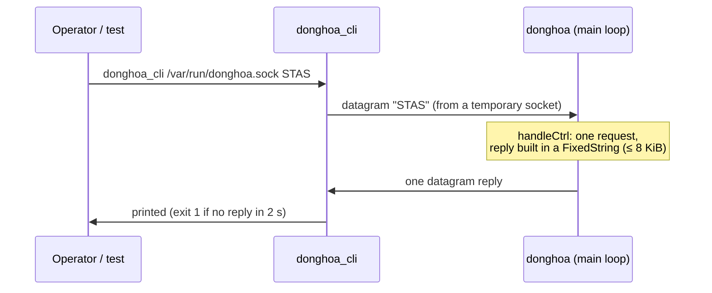
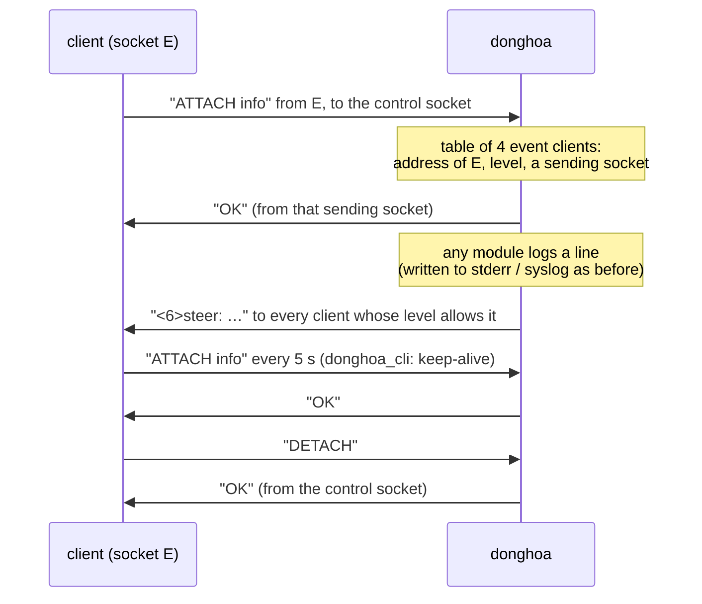
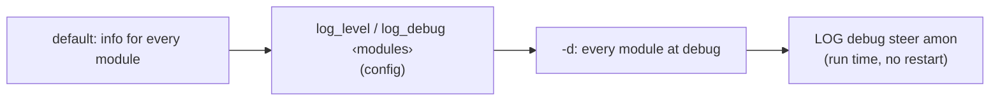

# 12. Control interface and logging

> **Source:** `src/daemon/ctrl.cpp`, `src/cli/donghoa_cli.cpp`, `src/base/log.{hpp,cpp}`,
> `src/io/rrm_log.cpp`, `src/core/metrics.{hpp,cpp}`, `src/base/os.cpp` (sockets) ·
> **Requirements:** IR-3, IR-4, IR-5, FR-OBS-1

## What it does

- A **control socket** (UNIX datagram, `ctrl_socket`) lets operators and
  tests query the daemon's state and give commands, without a restart.
- **`donghoa_cli`** sends one request and prints the reply, or, started
  without a command, is a shell that does so for each line of its input.
- **Events** (`ATTACH`): a control client can ask for the daemon's log lines
  as they are written, as `hostapd_cli` does with hostapd. An operator sees
  peers come and go and steers end without `logread`, and a script can wait
  for an event instead of polling `STAS`.
- **Per-module logging** with run-time levels, to stderr or syslog, with an
  optional decoded trace of every ARCP frame and 802.11 element.
- **Outcome counters** (`METRICS`): what steering, load balancing and ARCP
  did since start-up, in the Prometheus text format, so the effect of a
  configuration change can be measured instead of guessed.

## Data flow



The control socket is one more descriptor in the `poll()` loop; a request is
answered in the same loop iteration, so the reply is a consistent snapshot.

## Commands

| Command | Reply |
|---|---|
| `PING` | `PONG` |
| `STATUS` | AP id, name, boot id, `event_clients=<attached>/<limit>`, ports, air monitors, `survey=` and `station_dump=` statistics, each BSS: up/down, BSSID, channel, width, caps, MLD, load, `util_src=`, `sta_src=` |
| `PEERS` | each peer: name, port, age, its BSSes (channel, util, STA count, MLD) and radios |
| `STAS` | each local STA: BSS, RSSI, throughput, `flags=kvr`, beacon mode, bands (advertised, seen, 6 GHz block), class and `lp_score`, `roam_thr` (learned or default) and `roam_events`, backoff; MLD links; then `remote` STAs on peers |
| `STEERS` | running transactions (state, candidate i/n) and reservations |
| `DEVCLASS` | device class records: class, score, samples, source AP, age, and a learned `roam_thr` / `roam_events` |
| `CALIB` | learned uplink → downlink offsets per BSS (feature 9) |
| `BANDIT [mode <0|1|2> \| reset]` | contextual bandit for the target choice: mode, counters, learned mean per visited context; switch mode or clear (feature 16) |
| `DROPRX [<MESSAGE> <n>]` | fault injection: drop the next *n* received ARCP messages of that type (e.g. `STEER_RESP`) before ACK and processing, as a lossy link would; logged on every drop; `DROPRX` shows what is pending, `n = 0` cancels. For tests and diagnosis |
| `RL [mode <0|1|2> \| reset]` | Q-learning of when to roam: mode, counters, learned values per visited state; switch mode or reset to the prior (feature 15) |
| `STEER <sta> [<bssid>]` | start a manual steer (clears the STA's cooldown), optionally to one BSS |
| `MONITOR <sta> [<ms>]` | measure a STA with this AP's monitors / driver API; result in the log |
| `METRICS` | outcome counters and gauges, Prometheus text format (below) |
| `CHECK` | configuration findings against the peers: 802.11r / security of BSS pairs, steering settings (feature 18) |
| `LOG` | each module's level |
| `LOG <level> [<module>…]` | set the level (`err`, `warning`, `notice`, `info`, `debug`, or the RFC 5424 number 3–7) of all or some modules |
| `ATTACH [<level>]` | `OK`, then every log line up to that level (default `notice`) is sent to the sender's socket (Events, below); again from the same socket: changes the level |
| `DETACH` | `OK`: no more events to the sender; `FAIL not attached` |

Unknown commands get `UNKNOWN COMMAND`; bad arguments get `FAIL <usage>`.

### Shell mode

`donghoa_cli <sock>` without a command reads one command per line from
stdin and prints each reply, like `hostapd_cli`:

```
$ donghoa_cli /var/run/donghoa.sock
type a command, 'help' or 'quit'
donghoa> PING
PONG
donghoa> LOG debug steer
...
donghoa> quit
```

- The shell is entirely in the client. Every line is one ordinary request
  from a new temporary socket, so a late reply to one command can never be
  taken for the reply to the next.
- On a terminal the shell attaches for events (level `notice`) and prints
  them between the commands; `ATTACH <level>` changes the level, `DETACH`
  stops them. With piped input it does not attach unless a line says
  `ATTACH`, so a script gets the replies alone.
- `help` lists the commands, `quit`, `exit` or end of input (Ctrl-D) leaves.
  Both are answered by the client; blank lines and lines starting with `#`
  are skipped.
- The prompt appears only when stdin is a terminal. Piped input
  (`donghoa_cli <sock> < commands.txt`) gives the replies alone, so several
  commands can run from one script or one `ssh` call.
- The exit status is 1 if any command got `FAIL` or no reply, or a line was
  longer than a request (255 characters); such a line is not sent.
- There is no line editing or history (the binary needs libc only); run it
  under `rlwrap` where that is wanted. An event that arrives while a
  command is being typed is printed over the prompt; the prompt is shown
  again, the characters typed so far are still sent with Enter.

### Events

An event is one log line, in one datagram:

```
<N>module: message\n          N = RFC 5424 severity, 3 (err) … 7 (debug)
<5>peer: peer 02:00:00:00:00:02 (ap2) lost
<5>steer: steer #2 aa:bb:cc:dd:ee:17 (rssi) finished: success after 412 ms
```

It is the text that goes to stderr or syslog, with the severity as a
number in place of the time and tag, the form of hostapd's control
interface events. The messages are those of the log and are not a stable
interface of their own: a script should match on a module and a few words,
as it would with `logread`.



- **Which lines.** Those with a severity up to the client's level, out of
  the lines the daemon writes at all: a module at `info` produces no debug
  events until `LOG debug <module>` (per-module levels, below). The default
  level `notice` gives peers discovered and lost, BSSes up and down, steer
  outcomes and enrollment decisions.
- **A socket for events.** A client attaches from a socket it keeps open
  and bound to a path, and sends its commands from another one, as
  `donghoa_cli` does. Events and replies then never mix. On the event
  socket a datagram that starts with `<` is an event; anything else answers
  the client's own `ATTACH` or `DETACH`.
- **`OK` first.** The reply to `ATTACH` is the first datagram, the events
  follow; at `info` the first event is the line about the client itself
  (`<6>ctrl: event client attached at level info (1 of 4)`). The reply is
  sent the way the events will be, so `OK` means they can arrive. A socket
  that is not bound, or that is `connect()`ed to the control socket (it
  then takes datagrams from that socket alone), gets `FAIL cannot send
  events to your socket`.
- **Limit.** 4 clients (`MAX_EVENT_CLIENTS`); a fifth gets `FAIL 4 event
  clients attached already`. `STATUS` shows `event_clients=2/4`.
- **The daemon never waits for a client.** Each client is sent to without
  blocking and from a socket of its own, because the kernel charges unread
  datagrams to the sending socket: a client that stops reading fills only
  its own, and the replies to commands and the events of the other clients
  go on. What does not fit is dropped and counted
  (`donghoa_ctrl_events_dropped_total`); a client can so miss events when
  hundreds are written in a burst (all modules at debug).
- **Clients that left.** A client whose socket is closed or removed is
  taken out of the table when the next event for it cannot be sent, and one
  that has not read for 10 s too (`event client removed: gone` / `not
  reading`, counted in `donghoa_ctrl_event_clients_removed_total`). A
  restart of the daemon empties the table.
- **Cost.** Without a client, one comparison per log line. With clients,
  one `sendto` per client and line, on top of the write to stderr or syslog.
- **Not delivered:** the line that reports a client's removal, to any
  client (it is written while events are being sent), and a client's own
  `detached` line.

`donghoa_cli <sock> ATTACH [<level>]` prints events until it is interrupted
(Ctrl-C, SIGTERM) or its output closes, then sends `DETACH`:

```
$ donghoa_cli /var/run/donghoa.sock ATTACH
<5>peer: peer 02:00:00:00:00:02 discovered
<5>steer: steer #1 aa:bb:cc:dd:ee:17 (rssi) finished: success after 388 ms
^C
$ donghoa_cli /var/run/donghoa.sock ATTACH | grep -m1 'peer .* lost'    # wait for one event
```

- It exits with 1 at once when the daemon refuses or does not answer the
  first `ATTACH`, otherwise with 0.
- It repeats its `ATTACH` every 5 s. The daemon answers `OK` and changes
  nothing, but a daemon that was restarted learns about the client again,
  so a follower started once keeps working across restarts. After 12 s
  without an answer it writes `the daemon does not answer, waiting for it`
  to stderr, and `the daemon answers again` later. Events written while the
  daemon was away or before it was attached again are not replayed.
- Its event socket is `/tmp/donghoa_cli-<pid>-ev`, removed on exit.

## Logging

### Format

```
<monotonic seconds.ms> [<TAG>] <module>: <message>
382192.699 [INF] steer: steer #2 aa:…:17: BTM request -> 02:…:47:00 ch 36 (score -51)
```

Tags `ERR`, `WRN`, `NTC`, `INF`, `DBG`. Modules: `main`, `l2`, `msg`, `peer`,
`hapd`, `local`, `steer`, `policy`, `amon`, `survey`, `ctrl`, `config`,
`rrm`, `class`, `enroll`, `check`. The monotonic time matches `time.monotonic()`, so test
markers and logs of several APs can be merged by time.

### Levels

The levels are the RFC 5424 (syslog) severities, with their numbers. With
`-s` each line goes to syslog with exactly that priority, so `logread`,
remote syslog servers and log filters see standard severities.

| Level (number) | Tag | Used for | Examples |
|---|---|---|---|
| `err` (3) | `ERR` | the daemon cannot do something it should | socket or config failure, key file not writable |
| `warning` (4) | `WRN` | something is wrong but handled | message not acknowledged, hostapd rejected a BTM request, a setting differs from a peer's |
| `notice` (5) | `NTC` | normal but significant events | start / stop, peer discovered / lost / restarted, BSS up, hostapd connected, steer finished (with outcome) or without a suitable candidate, device class change, enrollment requests and decisions, findings cleared |
| `info` (6) | `INF` | routine operation | each step of a steer, STA association, measurements, offload decisions, records learned from peers |
| `debug` (7) | `DBG` | traces | ARCP frames, hostapd commands, per-poll values |

The default is `info`. `log_level notice` keeps only the significant
events, which suits the small `logread` buffer of a router. Names and
numbers are both accepted: `warn` and `error` are aliases, `emerg`,
`alert`, `crit` and 0–2 set `err` (the daemon has nothing more severe).



- Each file that logs declares its module
  (`constexpr LogModule LOG_MODULE{LogModule::STEER};`); the tag is added
  automatically, messages do not repeat it.
- Output to stderr, or with `-s` to syslog (facility daemon) with matching
  priorities. On OpenWrt the service uses `-s`; read with `logread -e donghoa`.

### Debug traces

| Module at debug | Shows |
|---|---|
| `msg` | every ARCP frame: direction, type, peer, port, try number |
| `hapd` | every hostapd command and event |
| `rrm` | decoded `SET_NEIGHBOR` (BSSID Information in words), `REQ_BEACON` (mode, channels, duration), `BSS_TM_REQ` (candidates, preference, MD bit), beacon reports |
| `steer` | candidate scores and the end of each MEASURE part |
| `class` | per-poll traffic rates, means, sigmas, S and θ |
| `survey` | time each nl80211 dump spent in the driver |

## Metrics

`METRICS` answers in the Prometheus text exposition format. To feed
node_exporter's textfile collector, for example from cron:

```sh
donghoa_cli /var/run/donghoa.sock METRICS > /tmp/node_exporter/donghoa.prom.$$ &&
  mv /tmp/node_exporter/donghoa.prom.$$ /tmp/node_exporter/donghoa.prom
```

Counters start at zero with the daemon and only grow. A series with value 0
is left out, so the reply fits one 8 KiB control datagram; it appears with
its first event. Labels: `bss` (the local interface), `reason` (`rssi`,
`load`, `band`, `manual`), `result`, `status`.

| Series | Kind | Meaning |
|---|---|---|
| `donghoa_uptime_seconds`, `donghoa_peers`, `donghoa_steer_active` | gauge | |
| `donghoa_config_issues` | gauge | consistency findings (feature 18) |
| `donghoa_bss_up`, `donghoa_bss_stations`, `donghoa_bss_util_pct` | gauge | per local BSS |
| `donghoa_steer_started_total{bss,reason}` | counter | transactions started from this BSS |
| `donghoa_steer_no_pool_total{bss,reason}` | counter | trigger fired, no BSS to measure at all |
| `donghoa_steer_total{bss,reason,result}` | counter | how they ended: `success`, `btm_reject`, `btm_timeout`, `roam_timeout`, `wrong_target`, `aborted`, `no_candidate` |
| `donghoa_btm_sent_total`, `donghoa_btm_accept_total`, `donghoa_btm_reject_total` `{bss,reason}` | counter | BTM requests and the STA's answers (each rejection counts, also when the next candidate is tried) |
| `donghoa_steer_gain_db_sum` / `_count` `{bss,reason}` | counter | target level − level when the steer started, over successes with a known level: the average gain is sum / count |
| `donghoa_steer_duration_ms_sum{bss,reason}` | counter | start to association, successes: average = sum / `steer_total{result="success"}` |
| `donghoa_steer_in_total{bss,status}` | counter | STEER_REQ answered as target: `accept`, `capacity`, `load`, `busy`, … |
| `donghoa_steer_in_success_total`, `donghoa_steer_in_failed_total` `{bss}` | counter | outcomes the source reported for accepted steer-ins |
| `donghoa_lb_offload_total`, `_effective_total`, `_futile_total`, `_no_verdict_total`, `_pause_total` `{bss}` | counter | load-balancing offloads and their feedback verdicts (feature 8) |
| `donghoa_arcp_rx_total`, `donghoa_arcp_tx_total` | counter | messages processed / sent |
| `donghoa_arcp_drop_total{reason}` | counter | received and dropped: `bad_header`, `auth`, `signature`, `untrusted`, `unverified_boot`, `duplicate` |
| `donghoa_arcp_retransmit_total`, `_ack_timeout_total`, `_queue_full_total` | counter | reliable unicast |
| `donghoa_ctrl_events_total`, `donghoa_ctrl_events_dropped_total` | counter | events sent to `ATTACH` clients / not sent because the client was not reading |
| `donghoa_ctrl_event_clients_removed_total` | counter | event clients removed because they left without `DETACH` or stopped reading |

Useful ratios: steering success rate = `steer_total{result="success"}` /
`steer_started_total`; BTM acceptance = `btm_accept_total` /
`btm_sent_total`; a growing `arcp_drop_total{reason="auth"}` means an AP
with the wrong key.

## Configuration

| Key | Default | Meaning |
|---|---|---|
| `ctrl_socket` | none (OpenWrt: `/var/run/donghoa.sock`) | Control socket path |
| `log_level` | info | Level of every module: `err`, `warning`, `notice`, `info`, `debug` or 3–7 |
| `log_debug <m1>,<m2> …` | — | Modules at debug |
| command line `-d` / `-s` / `-c <file>` | — | all debug / syslog / config file |

## Tests

- Unit `testLog`: level parsing, per-module masks, formatting.
- Unit `testMetrics`: outcome recording, gain and duration sums, the text
  form (labels, zero values left out, signed sums).
- itest PASS 25: `METRICS` after the earlier scenarios is valid Prometheus
  text and counts their steers, BTM answers, steer-ins, load-balancing
  verdicts and AP3's wrong-key frames.
- itest PASS 1: shell mode with piped input: replies in order, `help`,
  `quit`, comments, a failing command and an overlong line give exit
  status 1, `ATTACH` / `DETACH` lines.
- itest PASS 6: four event clients attach (`OK` before the first event),
  the fifth is refused, a bad level is refused, the same socket attaches
  again without a new slot, `DETACH` twice; an `info` client sees the lines
  about the others and no debug line; two clients that stop reading lose
  events (counted) while replies still arrive, then leave without `DETACH`
  and are removed; the `peer … lost` notice of the BYE reaches a raw client
  and `donghoa_cli ATTACH`, which detaches on SIGINT with status 0.
- The integration and system tests drive everything through
  `donghoa_cli` (`STATUS`, `PEERS`, `STAS`, `STEERS`, `DEVCLASS`, `STEER`,
  `MONITOR`, `METRICS`, `CHECK`, `LOG`).
