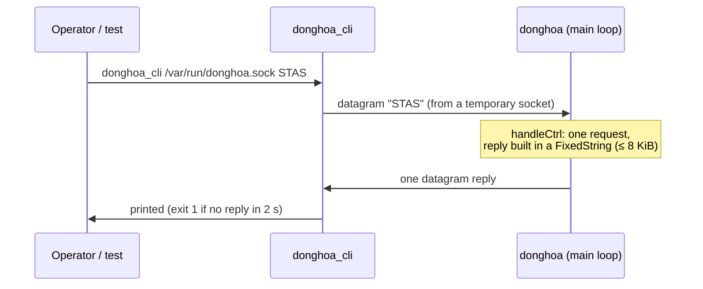
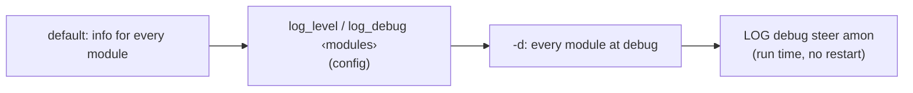

# 12. Control interface and logging

> **Source:** `src/ctrl.cpp`, `tools/donghoa_cli.cpp`, `src/log.{hpp,cpp}`,
> `src/rrm_log.cpp` · **Requirements:** IR-3, IR-4, IR-5

## What it does

- A **control socket** (UNIX datagram, `ctrl_socket`) lets operators and
  tests query the daemon's state and give commands, without a restart.
- **`donghoa_cli`** sends one request and prints the reply.
- **Per-module logging** with run-time levels, to stderr or syslog, with an
  optional decoded trace of every ARCP frame and 802.11 element.

## Data flow



The control socket is one more descriptor in the `poll()` loop; a request is
answered in the same loop iteration, so the reply is a consistent snapshot.

## Commands

| Command | Reply |
|---|---|
| `PING` | `PONG` |
| `STATUS` | AP id, name, boot id, ports, air monitors, `survey=` and `station_dump=` statistics, each BSS: up/down, BSSID, channel, width, caps, MLD, load, `util_src=`, `sta_src=` |
| `PEERS` | each peer: name, port, age, its BSSes (channel, util, STA count, MLD) and radios |
| `STAS` | each local STA: BSS, RSSI, throughput, `flags=kvr`, beacon mode, bands (advertised, seen, 6 GHz block), class and `lp_score`, backoff; MLD links; then `remote` STAs on peers |
| `STEERS` | running transactions (state, candidate i/n) and reservations |
| `DEVCLASS` | device class records: class, score, samples, source AP, age |
| `CALIB` | learned uplink → downlink offsets per BSS (feature 9) |
| `STEER <sta> [<bssid>]` | start a manual steer (clears the STA's cooldown), optionally to one BSS |
| `MONITOR <sta> [<ms>]` | measure a STA with this AP's monitors / driver API; result in the log |
| `LOG` | each module's level |
| `LOG <level> [<module>…]` | set the level (`err`, `warn`, `info`, `debug`) of all or some modules |

Unknown commands get `UNKNOWN COMMAND`; bad arguments get `FAIL <usage>`.

## Logging

### Format

```
<monotonic seconds.ms> [<TAG>] <module>: <message>
382192.699 [INF] steer: steer #2 aa:…:17: BTM request -> 02:…:47:00 ch 36 (score -51)
```

Tags `ERR`, `WRN`, `INF`, `DBG`. Modules: `main`, `l2`, `msg`, `peer`,
`hapd`, `local`, `steer`, `policy`, `amon`, `survey`, `ctrl`, `config`,
`rrm`, `class`. The monotonic time matches `time.monotonic()`, so test
markers and logs of several APs can be merged by time.

### Levels



- Each file that logs declares its module
  (`constexpr LogModule LOG_MODULE{LogModule::STEER};`); the tag is added
  automatically, messages do not repeat it.
- Output to stderr, or with `-s` to syslog (facility daemon) with matching
  priorities. On OpenWrt the service uses `-s`; read with `logread -e donghoa`.

### Debug traces

| Module at debug | Shows |
|---|---|
| `msg` | every ARCP frame: direction, type, peer, port, try number |
| `hapd` | every hostapd command and event |
| `rrm` | decoded `SET_NEIGHBOR` (BSSID Information in words), `REQ_BEACON` (mode, channels, duration), `BSS_TM_REQ` (candidates, preference, MD bit), beacon reports |
| `steer` | candidate scores and the end of each MEASURE part |
| `class` | per-poll traffic rates, means, sigmas, S and θ |
| `survey` | time each nl80211 dump spent in the driver |

## Configuration

| Key | Default | Meaning |
|---|---|---|
| `ctrl_socket` | none (OpenWrt: `/var/run/donghoa.sock`) | Control socket path |
| `log_level` | info | Level of every module |
| `log_debug <m1>,<m2> …` | — | Modules at debug |
| command line `-d` / `-s` / `-c <file>` | — | all debug / syslog / config file |

## Tests

- Unit `testLog`: level parsing, per-module masks, formatting.
- The integration and system tests drive everything through
  `donghoa_cli` (`STATUS`, `PEERS`, `STAS`, `STEERS`, `DEVCLASS`, `STEER`,
  `MONITOR`, `LOG`).
