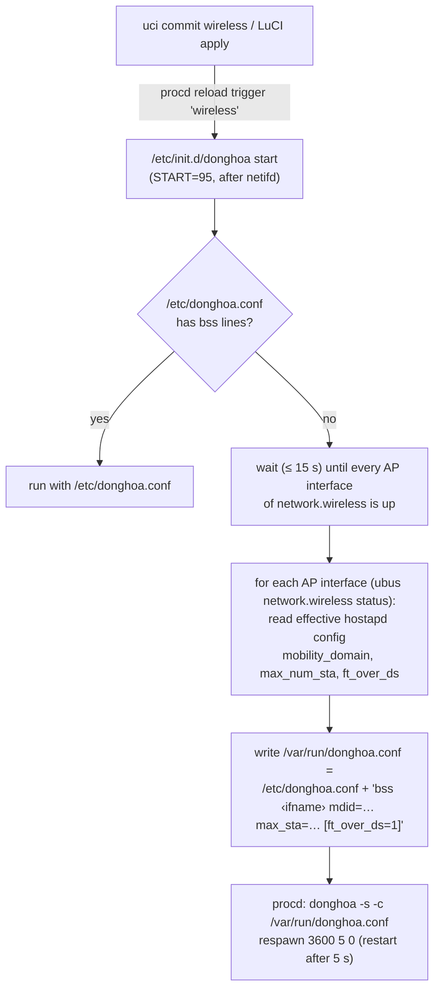
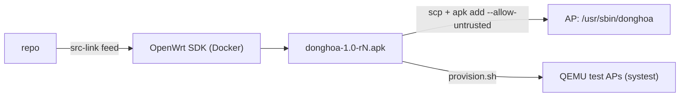

# 13. Configuration and OpenWrt integration

> **Source:** `src/config.{hpp,cpp}`, `donghoa.conf.example`,
> `openwrt/donghoa/` (Makefile, `files/donghoa.init`,
> `files/donghoa.conf`), `openwrt/build.sh`, `openwrt/qemu/` ·
> **Requirements:** IR-1, IR-12, C-3, C-4 · **Guide:**
> [openwrt/README.md](../../openwrt/README.md)

## What it does

- One plain-text configuration file, parsed strictly: a bad line stops the
  daemon with the file name and line number.
- On OpenWrt, a procd service that generates the `bss` lines from
  `/etc/config/wireless`, follows interface renames and wireless reloads, and
  restarts the daemon on failure.
- A package built with the official OpenWrt SDK; the binary needs only libc.

## Configuration file

```
# comment
name ap1
iface br-lan
key hex:2057acc9…72ab          # identical on every AP
ctrl_socket /var/run/donghoa.sock
bss ap-2g mdid=a1b2 max_sta=64
bss ap-5g mdid=a1b2 max_sta=64 ft_over_ds=1
rssi_low -75
band_steering 1
```

### Parsing (`parseConfigLine`)

```
for each line:
    strip comment and blanks; skip empty
    split "key value"
    known global key  → parse its value (range-checked numbers, MACs, paths)
    known policy key  → table POL_BOOLS / POL_INTS (bool 0/1, ranged int)
    "bss" / "iface" / "air_monitor" / … → repeatable entries (bounded)
    anything else or a bad value → error "<file>:<line>: invalid line", exit 1
```

Numbers use `std::from_chars` with range checks (`parseLong`), never a
throwing function. Every key, its default and unit is listed in
[SRS.md](../SRS.md) Appendix A and commented in `donghoa.conf.example`.

### Key groups

| Group | Keys (examples) | Feature |
|---|---|---|
| Identity and transport | `name`, `ap_id`, `iface`, `key`, `sim_port`, `sim_peer` | 1, 2 |
| hostapd | `bss`, `hostapd_ctrl_dir` | 4 |
| Timers | `*_interval_ms`, `peer_timeout_ms`, `*_timeout_ms` | 2, 5 |
| Triggers | `rssi_*`, `band_steer*`, `load_balancing`, `util_high` | 6, 7, 8 |
| Scoring | `score_model`, `rssi_hysteresis`, `util_weight`, `band_bonus_*`, `tput_*` | 5 |
| Load balancing | `lb_*`, `util_admit_max`, `idle_kbps`, `reserve_hold_ms` | 8 |
| AP-side measurement | `air_monitor`, `amon_*`, `sta_rssi_api` | 9 |
| Low-power | `lp_*` | 10 |
| Logging | `log_level`, `log_debug`, `ctrl_socket` | 12 |

## OpenWrt service



- The values come from the hostapd configs netifd generated, i.e. the
  **effective** values including defaults (`hostapd_bss_get`).
- An interface rename (e.g. `ap-5g` → `phy1-ap0`) regenerates the lines
  (systest S11).
- Without any AP interface up, the service logs an error and does not start.
- procd restarts the daemon 5 s after it exits, with no retry limit
  (`respawn 3600 5 0`: threshold 3600 s, timeout 5 s, retries 0 = unlimited).

### hostapd prerequisites

| Option | Why |
|---|---|
| `rrm_neighbor_report=1` | neighbor database (feature 3) |
| `rrm_beacon_report=1` | beacon requests (feature 5) |
| `bss_transition=1` | BTM requests |
| `ieee80211r=1`, `mobility_domain`, FT AKM | fast roaming; DongHoa warns if an MDID is set but hostapd has no FT AKM |
| `wpad` with 11k/v/r (e.g. `wpad-mbedtls`) | the basic variant lacks these |

## Package

| Item | Value |
|---|---|
| Build | `openwrt/build.sh [target/subtarget] [release]`: official SDK in Docker, prints the `.apk` (25.x) or `.ipk` (24.x) path |
| Contents | `/usr/sbin/donghoa`, `/usr/sbin/donghoa_cli`, `/etc/init.d/donghoa`, `/etc/donghoa.conf` (conffile, kept on upgrade) |
| Dependencies | libc only (`make check-deps`: no `libstdc++.so`; no heap, exceptions or RTTI) |
| Release | `PKG_RELEASE` in `openwrt/donghoa/Makefile` must change for every build installed over an older one: `apk add` keeps an installed package of the same version |



## Failure handling

| Situation | Behaviour |
|---|---|
| Bad configuration value | exit 1 with `<file>:<line>: invalid line` (systest S12) |
| `bss` names an interface without a hostapd socket | that BSS stays down, retried every 5 s |
| `mdid` set but no FT AKM in hostapd | warning at start |
| Key missing on one AP | it cannot authenticate with the others (feature 1) |

## Tests

- Unit `testConfig`: every key type, ranges, repeatable entries, errors with
  line numbers.
- systest S11 (UCI rename regenerates `bss` lines), S12 (strict parsing),
  package installed with plain `apk add` on both VMs.
