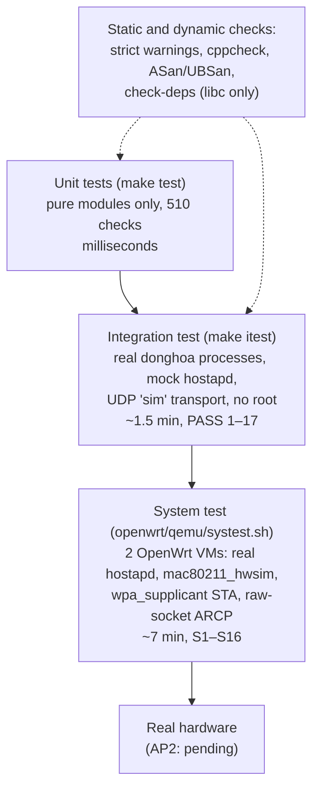

# 14. Verification

> **Source:** `tests/test_unit.cpp`, `tests/itest.py`,
> `tests/mock_hostapd.py`, `openwrt/qemu/systest.sh` · **Requirements:**
> NFR-MNT, verification matrix in [SRS.md](../SRS.md) §6

## Test levels

| Level | Command | What it proves | What it cannot |
|---|---|---|---|
| Unit | `make test` | Byte layouts, parsers, every policy formula and gate, against known values and malformed input | Behaviour over time, I/O |
| Integration | `make itest` | Whole daemons interacting: timing, state machines, protocol, failure paths, scale (12 APs) | Real hostapd/kernel formats |
| System | `openwrt/qemu/systest.sh` | Real 802.11k/v/r frames, real hostapd control interface, real nl80211, packaging, init script | Real RF, real client quirks, real drivers |

## Unit tests (`tests/test_unit.cpp`)

One binary linking only the pure modules (`text`, `proto`, `rrm`, `policy`,
`config`, `sha256`, `hapd_parse`, `nlparse`, plus `log`/`os` helpers).

| Group | Covers |
|---|---|
| `testSha256` | SHA-256 and HMAC known vectors |
| `testProtoRoundtrip`, `testProtoOverflow`, `testSteerTlvs` | every TLV encode/decode, longer TLVs from newer peers, full messages |
| `testRrm` | Neighbor Report element, BSSID Information, Beacon Request (Channel 255 + AP Channel Reports), Beacon Report parsing, op class → band |
| `testHapdParsers` | hostapd `STATUS`, `STA` (flags, op classes, AKM, PHY caps, MLD), events |
| `testPolicy`, `testPolicyTput` | triggers, freshness, gates, floors, both models, sigmoid table, admission, backoff, pool ranking, LB feedback |
| `testAirMonitor` | radiotap alignment, extended bitmaps, frame filter, monitor TLVs, config |
| `testRobustness` | range-checked number parsing, struct comparison |
| `testLog`, `testConfig` | levels and masks; every key, ranges, errors with line numbers |
| `testMlo` | BSS_INFO trailer, `isSameMld`, `peer_addr` parsing |
| `testLowPower` | Welford statistics, S, θ, hysteresis, traces, gates, PHY exclusion |
| `testNlParse` | nl80211 station entries: nesting, 64-bit counters, rates, flags, truncated input |

## Integration test (`tests/itest.py`)

Real `donghoa` binaries, one Python mock hostapd world (control sockets,
events, beacon reports, BTM, roaming), ARCP over UDP on loopback. Each
scenario writes `=== Sn` markers into every AP log; `merged.log` interleaves
all APs by time (`DONGHOA_KEEP_LOGS=1` keeps them).

| PASS | Scenario | Feature |
|---|---|---|
| 1 | Discovery, BSS/load exchange, 11k neighbor DB (MD bit) | 1, 2, 3 |
| 2 | AP with the wrong key not accepted | 1 |
| 3 | RSSI roam: passive beacon report → STEER_REQ/RESP → BTM → roam | 5, 6 |
| 4 | Load balancing offloads an idle STA from busy AP2 | 8 |
| 5 | STA without 11k measured by the peer's monitor and steered | 9 |
| 6 | BYE removes the peer and its neighbor entries | 2, 3 |
| 7 | Band steering: 2.4-only STA skipped, dual-band steered, backoff | 7 |
| 8 | 6 GHz rules (WPA3 / WPA2-PSK / op classes) | 7 |
| 9 | MLO: one entry per MLD STA, no band steer onto own link, all-links-weak rule | 11 |
| 10 | Low-power: sensor yes, phone no, VHT no, HE-only yes; shared, survives restart, follows roam, corrections synced | 10 |
| 11 | Driver RSSI API: unsupported answered at once; measured STA steered | 9 |
| 12 | 12 APs / 23 candidate BSSes: STA reaches the one BSS it hears | 5 |
| 13 | Idle STA's stale weak signal ignored | 4, 6 |
| 14 | Load balancing pauses when offloading does not help | 8 |
| 15 | AP with 17 BSSes: manages 16 with a warning, the peer receives all 16 (largest HELLO/BSS_STATUS) | 2, 13 |
| 16 | Uplink/downlink offset learned per BSS; STA without 11k scored at uplink + offset | 9 |
| 17 | Per-STA roaming threshold: refusals lower it, STA then left alone, shared, own roam updates it | 6 |

`DONGHOA_ITEST_EXTRA="score_model 1"` reruns everything under the
throughput model (7–9 are skipped there by design: the mock BSSes are all
20 MHz).

## System test (`openwrt/qemu/systest.sh`)

Two x86-64 OpenWrt 25.12 VMs under QEMU/KVM, each an AP with two hostapd
BSSes on `mac80211_hwsim` (2.4 and 5 GHz, FT-PSK, 11k, 11v); VM1's spare
radio is a `wpa_supplicant` STA; ARCP runs on a shared Ethernet segment. The
run shortens the cooldown, turns on `log_debug steer,amon`, turns low-power
classification off except in S15 (see feature 10, limitations), stops both
daemons before starting either (no class records survive), and restores
`/etc/donghoa.conf` and `/etc/config/wireless` at the end.

| S | Scenario | S | Scenario |
|---|---|---|---|
| 1 | Peer discovery, HMAC | 9 | Radiotap monitor RSSI = station table |
| 2 | Neighbor DB from peers | 10 | hostapd restart, reconnect |
| 3 | STA tracked, `flags=kvr` | 11 | `bss` lines follow a UCI rename |
| 4 | Manual steer 5→2.4 GHz (11k + BTM + FT) | 12 | Strict config parsing |
| 5 | Automatic band steer 2.4→5 GHz | 13 | BYE + wrong key, recovery |
| 6 | Cross-AP negotiation, BTM reject, reservation released | 14 | AP-side measurement exchange |
| 7 | Throughput model: no steer when not faster | 15 | Low-power class on real counters |
| 8 | Throughput model: steer to VHT80 | 16 | STA metrics from nl80211 station dumps |

Run with `openwrt/qemu/systest.sh` (all) or `systest.sh S4 S9` (S3 always
runs; S5 also runs S4).

## Static and dynamic checks

| Check | Command |
|---|---|
| Strict warnings (`-Wconversion -Wsign-conversion -Wold-style-cast -Wuseless-cast -Wpedantic …`) | `make` (must stay warning-free) |
| libc only | `make check-deps` |
| Static analysis | `make cppcheck` (in a container if missing) |
| Sanitizers | `make CXXFLAGS="-O1 -g -fsanitize=address,undefined" donghoa donghoa_cli && make itest`, then grep the kept logs for `runtime error` |
| Mutation checks | each new rule was disabled once to confirm its test fails |

## Not yet verified

- Real hardware and real clients (AP2 deployment pending): RF behaviour,
  client BTM/11k quirks, real driver survey and station-dump fields,
  `util_src` on a real radio.
- Message load between APs at 10+ APs (functional at 12 APs, traffic not
  measured).
- The driver per-STA RSSI API (vendor placeholder).
