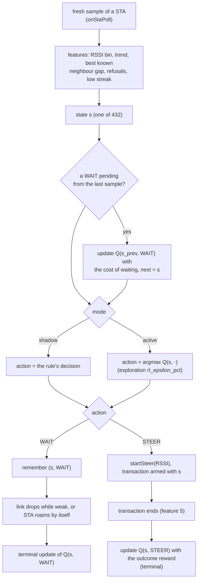
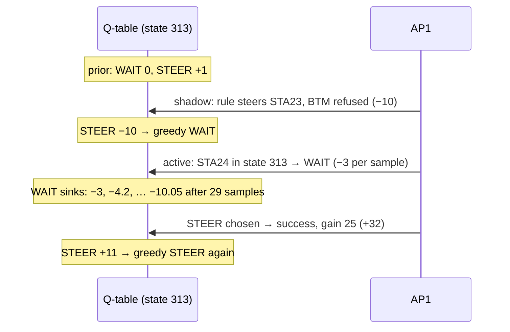

# 15. Q-learning: when to roam

> **Source:** `src/policy.{hpp,cpp}` (`rlState`, `rlInit`, `rlChoose`,
> `rlUpdate`, `rlReward*`), `src/steer.cpp` (`onStaPoll`, `endTxn`,
> `failTxnNoCandidate`, `rlLearn`), `src/local.cpp` (trend input, link
> drop), `src/ctrl.cpp` (`RL`) · **Requirements:** FR-TRG-8

## What it does

The rule-based RSSI trigger (feature 6) steers a STA once its signal stays
below a threshold. Whether that is the right moment depends on things the
rule does not weigh: is the signal falling or recovering, is a better
neighbour already known, has this STA refused before. **Q-learning** learns,
from what actually happens afterwards, the value of *waiting* versus
*steering now* in each situation, and (in active mode) decides with it.

It is built for an embedded AP: a few hundred states, integer arithmetic,
one fixed table, learning from the tens of decisions a day an AP sees.

Q-learning is **off by default**. Enable it in the configuration file
(`rl_roam 1` or `rl_roam 2`) or at run time, without a restart:
`donghoa_cli <sock> RL mode 1` (shadow) or `RL mode 2` (active);
`RL mode 0` turns it off again (the table is kept).

| Mode (`rl_roam`) | Behaviour |
|---|---|
| **0 off** (default) | rule only; nothing is learned |
| 1 shadow | the rule decides; the table learns from every decision the rule makes and its outcome, without changing behaviour. The recommended first step on a new network |
| 2 active | the table decides WAIT / STEER on each fresh sample; small exploration in safe states |

## Data flow



## Algorithm

### State (`policy::rlState`, 432 states)

| Feature | Bins |
|---|---|
| Smoothed RSSI | ≥ −60, −60…−65, −65…−70, −70…−75, −75…−80, < −80 dBm |
| Trend (RSSI change since the previous fresh sample) | falling (≤ −1 dB), stable, rising (≥ +1 dB) |
| Best known neighbour gap (best level of another BSS measured in the last 2 min − RSSI) | unknown, worse (< 0), 0…7 dB, ≥ 8 dB |
| Refusals (steer failures in a row) | 0, 1, ≥ 2 |
| Low streak (`lowCount ≥ rssi_low_count`, against the STA's own threshold, feature 6) | no, yes |

Decisions are recorded only below −60 dBm; stronger STAs always wait.

### Actions and rewards

| Action → what happened | Reward (dB-like units) |
|---|---|
| STEER → success at the target | +8 + gain (target level − level at the start, capped at 24) |
| STEER → associated elsewhere | +4 |
| STEER → BTM rejected or not answered | −10 |
| STEER → accepted, never arrived | −6 |
| STEER → no suitable candidate | −2 (a wasted measurement) |
| WAIT → next fresh sample | −(−70 − RSSI + 2)/4 below −70 dBm (e.g. −3 at −82), else 0 |
| WAIT → link dropped while below `rssi_low` | −20 |
| WAIT → STA roamed by itself | 0 |

STEER outcomes are terminal (after a roam the STA belongs to another AP).

### Update (`policy::rlUpdate`)

```
Q(s,a) ← Q(s,a) + α · (r + γ · max_a' Q(s',a') − Q(s,a))       (terminal: no γ term)
α = 1/(n+1) for the first visits, then 1/8        γ = 0.8
Q in fixed point ×256, clamped to ±1000
```

### Safe start: a prior equal to the rule

`rlInit` sets Q(s, STEER) = +1 where the rule fires (below −75 dBm with a
low streak) and −1 elsewhere, Q(s, WAIT) = 0. A fresh table in active mode
therefore behaves like the rule; learning only moves it where outcomes
disagree. `RL reset` restores this prior.

### Exploration (active mode only)

With probability `rl_epsilon_pct` [1 %] the other action is taken, but a
STEER is explored only in safe states: below −65 dBm and no neighbour known
to be worse. Exploring a WAIT (one more poll) is always safe. All existing
gates still apply: cooldown and backoff, the candidate gates of feature 5,
`lp_no_steer`.

### Example (itest PASS 18)

1. Shadow: a STA at −80 dBm refuses the rule's BTM request. State 313
   (−75…−80, stable, neighbour unknown, 0 refusals, low streak):
   Q(STEER) +1 → **−10**, greedy action now WAIT.
2. Active: a new STA in the same state is **not** steered when the rule would
   have (after ~2 s). Each fresh sample at −80 costs −3, so Q(WAIT) sinks;
   after 29 samples it falls below −10 and the STA is steered (7.4 s).
3. That steer succeeds with a 25 dB gain (+32): Q(STEER) −10 → **+11**.



## Configuration

| Key | Default | Meaning |
|---|---|---|
| `rl_roam` | 0 | 0 off, 1 shadow, 2 active (also `RL mode <n>` at run time) |
| `rl_epsilon_pct` | 1 | Exploration in active mode (0–100) |

## Observability

```
donghoa_cli <sock> RL
  rl mode=off epsilon=1% decisions=0 steers=0 explored=0 updates=0      # default
donghoa_cli <sock> RL mode 1     # enable: shadow (learn only)
  OK mode shadow
  q 313 rssi=-75..-80 trend=stable gap=unknown refusals=0 streak=1 wait=+0.0 steer=-10.0 n=0/1 greedy=wait
donghoa_cli <sock> RL mode 2     # switch at run time (no restart, table kept)
donghoa_cli <sock> RL reset      # back to the rule-based prior
donghoa_cli <sock> LOG debug steer   # "rl sta …: state … steer reward -10 -> Q 256 -> -2560 (x256)"
```

Only visited states are listed; the others still hold the prior.

## Tests

- Unit: every feature combination maps to a distinct state; the prior equals
  the rule; exploration never steers in unsafe states; first-visit and
  converged updates; discounted non-terminal update; rewards; config ranges.
- itest PASS 18 (enabled with `RL mode 1`, shadow learning, active waiting
  then steering, learning from the success, `RL mode 0` again); fails if
  active mode ignores the table.
- The whole itest also passes with `DONGHOA_ITEST_EXTRA="rl_roam 1"` (every
  scenario with shadow learning on), which shows that shadow learning changes
  no behaviour.
- systest: 16/16 (Q-learning off, the default).

## Limitations and next steps

- The table lives in memory: lost on restart, learned per AP, not shared.
  Averaging tables over ARCP (weighted by visit counts) is the natural next
  step.
- Shadow mode learns only the actions the rule takes, so Q(STEER) in states
  where the rule never steers keeps its prior until active exploration.
- The decision log from the proposal (context, options, action, probability,
  reward) is not built yet; it would allow evaluating a new policy offline
  before switching an AP to active mode.
- Rewards are hand-designed; ping-pong (return within 60 s) is not yet
  penalised.
