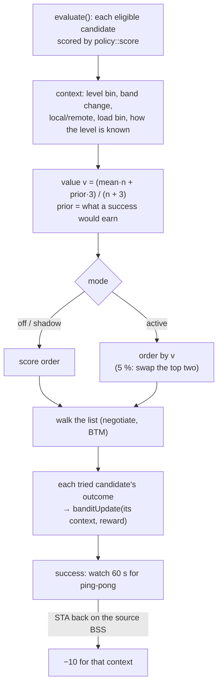

# 16. Contextual bandit: which target

> **Source:** `src/policy.{hpp,cpp}` (`banditCtx`, `banditPriorDb`,
> `banditValue`, `banditUpdate`), `src/steer.cpp` (`evaluate`,
> `banditCredit`, ping-pong watch), `src/local.cpp` (ping-pong check),
> `src/ctrl.cpp` (`BANDIT`) · **Requirements:** FR-STR-11

## What it does

The steering engine (feature 5) picks the target with a hand-written score:
level, band bonus, load. Some targets fail in ways the score cannot see: a
client that always refuses a certain AP, a band that looks good but whose
roams bounce back. The **contextual bandit** learns, from the outcome of
each target actually tried, which kind of candidate works, and (in active
mode) orders the eligible candidates by that learned value.

It never widens the choice: every gate of feature 5 (eligibility, minimum
level, load, admission) still applies. It only changes the **order** in
which eligible candidates are tried.

Like the Q-learning of feature 15, it is **off by default**:

| Mode (`bandit_target`) | Behaviour |
|---|---|
| **0 off** (default) | the score orders candidates; nothing is learned |
| 1 shadow | the score orders candidates; the bandit learns from their outcomes |
| 2 active | eligible candidates are ordered by learned value; in `bandit_epsilon_pct` [5 %] of steers the top two are swapped (exploration) |

Enable in the configuration (`bandit_target 1|2`) or at run time with
`donghoa_cli <sock> BANDIT mode 1|2` (`BANDIT mode 0` turns it off, the table
is kept).

## Data flow



## Algorithm

### Context (`policy::banditCtx`, 216 contexts)

| Feature | Bins |
|---|---|
| Candidate level (as used for the score) | ≥ −55, −55…−62, −62…−70, < −70 dBm |
| Band change | lower, same, higher |
| Location | remote AP, this AP |
| Candidate utilisation | < 30 % (or unknown), 30…55 %, > 55 % |
| How the level is known | STA's 802.11k report, AP-side measurement, unmeasured (floor value) |

The table is shared by all STAs of the AP: it learns about *kinds* of
candidates, not about individual STAs.

### Value with a prior

```
prior_dB = 8 + clamp(candidate level − STA's current level, 0, 24)     # a success's reward
v        = (mean × n + prior × 3) / (n + 3)                             # ×256 fixed point
```

With no evidence (n = 0) the value is the prior, so candidates are ranked by
expected gain; as outcomes accumulate, they dominate. Three samples are
enough to outweigh the prior.

### Rewards (for the candidate tried)

| Outcome of that candidate | Reward |
|---|---|
| Success at it | +8 + gain (≤ 24) |
| STA associated elsewhere | +4 |
| BTM rejected or not answered | −10 |
| Accepted, never arrived | −6 |
| Target AP refused, or did not answer (STEER_RESP) | −2 |
| **Ping-pong**: after a success, the STA is back on the BSS it was steered away from within 60 s | −10 (extra sample) |
| Aborted (STA left during MEASURE/NEGOTIATE) | none |

The mean is updated with α = 1/(n+1) for the first samples, then 1/8.

### Example (itest PASS 21)

| Candidate | Score | Context learned (shadow) | Value in active mode |
|---|---|---|---|
| AP2 5 GHz, −55 dBm | **−55 (first)** | STA refused: −10, n = 1 | (−10 + 32·3)/4 = 21.5 |
| AP1 2.4 GHz, −58 dBm | −58 | success, gain 24: +32, n = 1 | (32 + 32·3)/4 = **32 (first)** |

Shadow: the first STA's steer tries AP2 (rejected), then AP1 2.4 GHz
(success). Active: the next STA in the same situation gets its first and
only BTM request for AP1 2.4 GHz, `bandit puts 02:…:01:01 first (score
order: 02:…:02:00)`. When the first STA then returns to its original BSS,
`ping-pong` is logged and that context gets −10.

## Configuration

| Key | Default | Meaning |
|---|---|---|
| `bandit_target` | 0 | 0 off, 1 shadow, 2 active (also `BANDIT mode <n>`) |
| `bandit_epsilon_pct` | 5 | Active mode: % of steers that swap the top two eligible candidates |

## Observability

```
donghoa_cli <sock> BANDIT
  bandit mode=shadow epsilon=5% reordered=0 explored=0 updates=2
  ctx 18 level=>=-55 band=same remote util=<30 src=11k mean=-10.0 n=1
  ctx 63 level=-55..-62 band=lower local util=<30 src=11k mean=+32.0 n=1
donghoa_cli <sock> BANDIT mode 2
donghoa_cli <sock> BANDIT reset
donghoa_cli <sock> LOG debug steer   # "bandit <bssid>: context … reward … -> mean …"
```

## Tests

- Unit: every feature combination maps to a distinct context; unknown load
  counts as light; prior values; one sample against the prior; evidence
  outweighing the prior; config ranges.
- itest PASS 21 (shadow learning from a rejection and a success, active
  reordering, ping-pong); fails if active mode ignores the values. The whole
  itest also passes with `bandit_target 1` on every AP (shadow changes no
  behaviour). Skipped under `score_model 1`, whose score orders these
  candidates differently.
- systest: 16/16 (bandit off, the default).

## Limitations

- The table lives in memory per AP: not persisted, not shared yet.
- Contexts describe candidates, not clients: a STA-specific aversion (one
  client refusing one AP) is learned as a property of that kind of
  candidate until enough other STAs succeed there.
- Exploration only swaps the top two eligible candidates.
