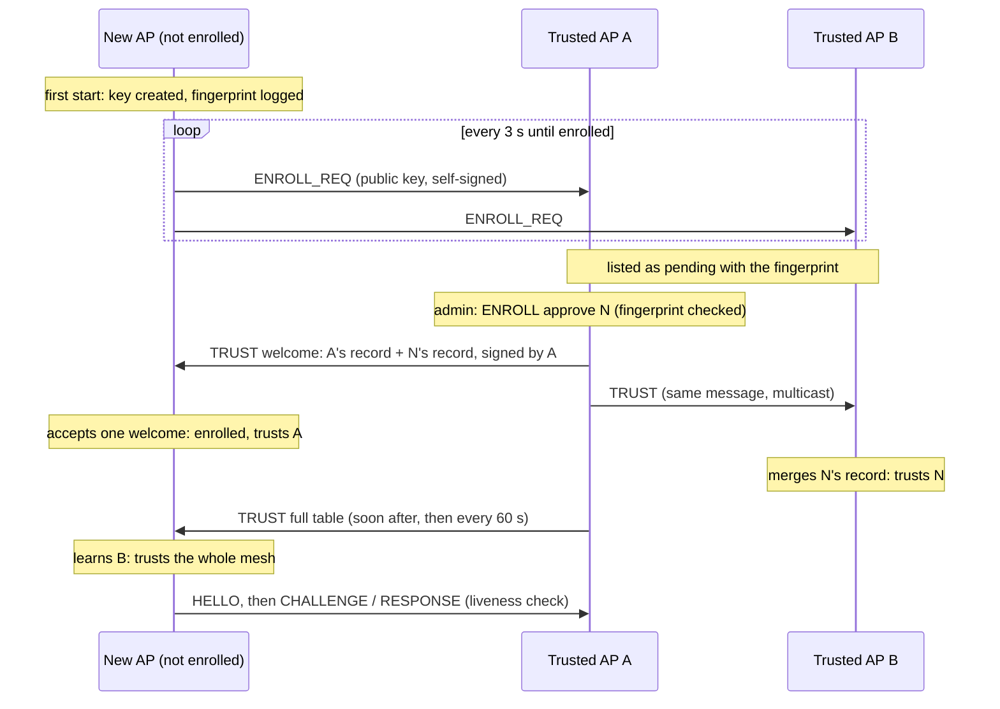
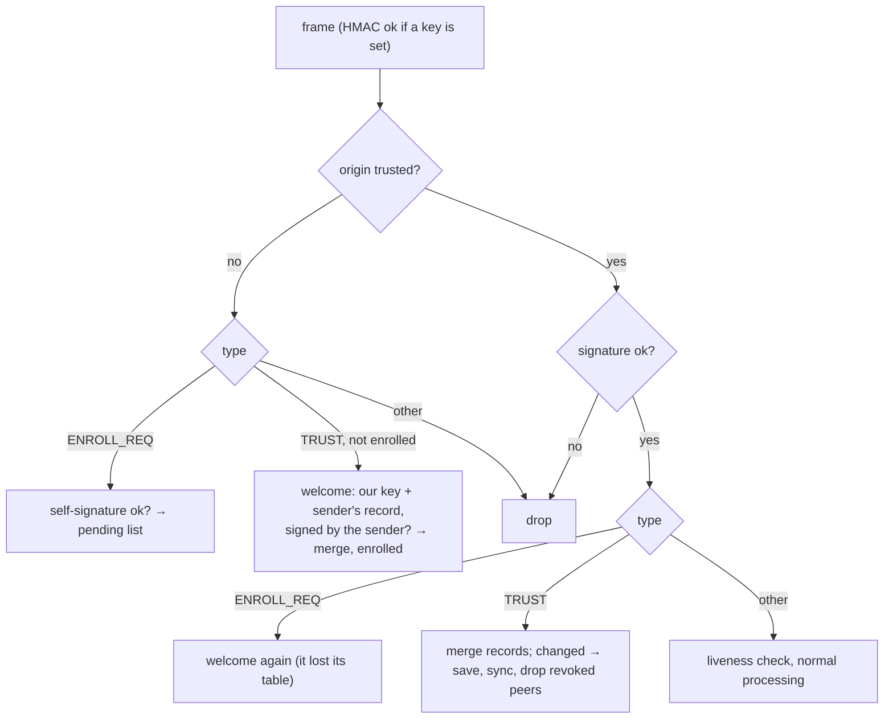

# 17. Automatic key enrollment

> **Source:** `src/trust.{hpp,cpp}` (trust table, merge rule, file form),
> `src/enroll.cpp` (keys, requests, welcome, sync, `ENROLL`),
> `src/msg.cpp` (receive path), `src/ed25519.cpp` · **Spec:**
> [PROTOCOL.md](../PROTOCOL.md) §10 · **Requirements:** FR-SEC-8..FR-SEC-11

## What it does

Per-AP signatures (feature 1) stop one compromised AP from speaking for the
others, but on their own they need a `sign_seed` and a full `peer_key` list
typed into every AP. With `enroll 1` the keys manage themselves:

1. A new AP creates its own Ed25519 key on first start (`seed_file`, mode
   0600) and logs its **fingerprint**.
2. Until it is enrolled, it multicasts an **enrollment request**: its public
   key, signed with that key.
3. Every trusted AP lists the request as pending: `donghoa_cli <sock>
   ENROLL` shows the ap_id and fingerprint.
4. The administrator compares the fingerprint with the one the new AP logs
   (or shows in `STATUS`) and runs `ENROLL approve <ap_id>` on **any**
   trusted AP.
5. That AP adds the key to its **trust table**, welcomes the new AP and
   spreads the table to the whole mesh. Every AP keeps it in `trust_file`.

Nothing joins without an approval. Removing an AP is one command
(`ENROLL revoke <ap_id>`) on any trusted AP, and it reaches every AP.

## Data flow



## Algorithm

### Trust table (`trust.cpp`)

One record per ap_id: public key, state (trusted / revoked), generation.

| Event | Record |
|---|---|
| `peer_key` line in the configuration | trusted, generation 0 (anchor) |
| This AP itself, first start | trusted, generation 0 |
| `ENROLL approve <ap_id>` | trusted with the pending key, generation + 1 |
| `ENROLL revoke <ap_id>` | revoked (key kept), generation + 1 |

**Merge (last writer wins):** a received record replaces the local one if its
generation is higher; at equal generation "revoked" wins, then the larger
key. Every AP applies the same rule, so all tables converge to the same
content whatever the order of messages, and:

- a stale copy never undoes a revocation (its generation is lower);
- approving a re-flashed AP's new key (generation + 1) wins over an old
  revocation;
- replaying an old TRUST message changes nothing.

### Receive path



TRUST messages from a trusted AP are merged without waiting for the liveness
check: they are signed, and a replayed record loses the merge, so a newly
welcomed AP learns the rest of the mesh from the first sync.

### Welcome

An AP that is not enrolled (its table holds no other trusted AP, and it was
not marked with `ENROLL init`) accepts exactly one TRUST message as its
welcome: it must contain this AP's own key as trusted and the sender's own
trusted record, and be signed with that sender key. The AP then merges the
records, becomes enrolled (kept in `trust_file`) and never accepts a welcome
again. The welcomer's ap_id and fingerprint are logged
(`enrolled: welcomed by …`), for the administrator to check.

### Spreading the table

- After every change: the whole table, multicast, 0.3 s later (several
  changes go out together), by every AP whose table changed. The flood stops
  by itself when nothing changes any more.
- Every 60 s, and to a peer that appeared or restarted: the whole table.
- Records go 29 to a message (43 bytes each, the sender's own record first).
- When a record turns to revoked, peers with that ap_id are removed at once.

## Configuration

| Key | Default | Meaning |
|---|---|---|
| `enroll` | 0 | 1: automatic enrollment (implies per-AP signatures) |
| `seed_file` | `/etc/donghoa.seed` | This AP's key; created (0600) on first start if missing. A `sign_seed` line overrides it. |
| `trust_file` | `/etc/donghoa.trust` | The trust table, rewritten atomically on every change |
| `peer_key` | — | Optional fixed anchors (generation 0) |

On OpenWrt both files are listed in `/lib/upgrade/keep.d/donghoa`, so they
survive a sysupgrade.

## Observability

```
donghoa_cli <sock> STATUS        # auth hmac=on ed25519=on enroll=pending|enrolled, fingerprint=…
donghoa_cli <sock> ENROLL
  enroll ap_id=02:00:00:00:00:80 fingerprint=1a2b-3c4d-5e6f-7a8b enrolled=yes
  pending 02:00:00:00:00:83 fingerprint=9f0e-… seen=1s ago
  trusted 02:00:00:00:00:80 fingerprint=1a2b-… gen=0 (this AP)
  trusted 02:00:00:00:00:81 fingerprint=… gen=1
  revoked 02:00:00:00:00:82 fingerprint=… gen=2
donghoa_cli <sock> ENROLL approve 02:00:00:00:00:83
donghoa_cli <sock> ENROLL revoke 02:00:00:00:00:82
donghoa_cli <sock> ENROLL init   # first AP of a new mesh: closed to welcomes
```

Log module `enroll`: key created, fingerprint at start-up, each new request
(`KEY CHANGE` when the ap_id already has another key), approvals,
revocations, welcomes, records learned from other APs.

## Tests

- Unit (`testTrust`): merge order (stale copy, revocation, re-approval,
  ties), approve / revoke, file round trip and invalid files, fingerprint
  form, TRUST_REC and ENROLL_KEY TLVs.
- itest PASS 24: four APs with empty files create keys and ask; E2 approved
  on E1 by fingerprint is welcomed; E3 approved on E2 reaches E1 through the
  sync; E4 (group key, never approved) stays out; forged TRUST from an
  untrusted origin and an ENROLL_REQ not signed with its announced key are
  ignored; a revocation spreads and drops the AP; key and trust table
  survive a restart.

## Limitations

- **Welcome of an AP not yet enrolled:** until its first welcome, a new AP
  trusts whoever welcomes it with its own key. Someone who holds the group
  key (if set) and sees the AP's enrollment request could welcome it into a
  mesh of their own. Check the `enrolled: welcomed by …` log line on a new
  AP, or run `ENROLL init` on the first AP of a mesh right away.
- Any trusted AP can approve and revoke: a compromised trusted AP can add
  keys until it is revoked itself.
- The pending list holds 8 requests and the trust table 64 APs.
