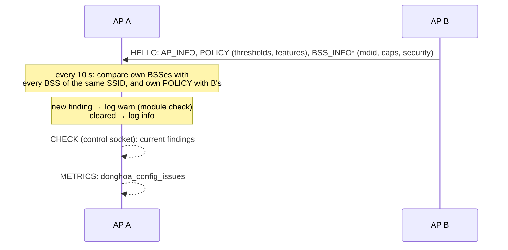

# 18. Configuration consistency check

> **Source:** `src/consistency.{hpp,cpp}` (comparisons, pure),
> `src/check.cpp` (timer, log, `CHECK`), `src/msg.cpp` (POLICY in HELLO) ·
> **Spec:** [PROTOCOL.md](../PROTOCOL.md) §11 · **Requirements:** FR-OBS-2

## What it does

Fast roaming between APs only works when every AP of a network is
configured the same way. A wrong mobility domain or one AP without 802.11r
does not fail loudly. STAs still roam, but with a full authentication that
costs hundreds of milliseconds, and nobody notices until calls drop.
Different steering thresholds on two APs make STAs ping-pong or get steered
unevenly.

Every AP compares itself with every peer, from what the peers already
advertise, and reports what differs:

| Finding | Between | What it breaks |
|---|---|---|
| `mdid_differs` | two BSSes of one SSID, both 802.11r | different mobility domains: roams between them need a full authentication |
| `ft_one_sided` | two BSSes of one SSID | 802.11r on one only: no fast roaming between them |
| `ft_over_ds_differs` | same mobility domain | FT over DS on one only: STAs may fall back to FT over the air |
| `security_differs` | two BSSes of one SSID | open and secured under one SSID: a STA cannot roam between them |
| `policy_differs` | this AP and a peer | any steering setting carried in POLICY (below) |

The BSS pairs include this AP's own BSSes (e.g. its 2.4 and 5 GHz BSS of
one SSID). Links of one Wi-Fi 7 AP MLD are not compared with each other.

The check only reports. It never changes behaviour, and it is always on: it
costs one comparison pass every 10 s and 16 bytes in each HELLO.

## Data flow



## Steering settings compared (POLICY TLV)

Features on or off: `rssi_steering`, `load_balancing`, `band_steering`,
`band_steer_6g`, `lp_no_steer`, `roam_thr_learn`, `lb_only_idle`.
Values: `rssi_low`, `rssi_hysteresis`, `rssi_min_target`,
`band_steer_rssi`, `band_steer_6g_rssi`, `util_high`, `util_admit_max`,
`lb_margin`, `score_model`, `steer_cooldown_ms` (in seconds).

The learning modes (`rl_roam`, `bandit_target`) are not compared. Running
them on one AP only is a legitimate trial, and they can change at run time.

## Observability

```
donghoa_cli <sock> CHECK
mdid_differs bss wlan1 02:…:10:00 peer 02:00:00:00:00:02 bss 02:…:20:00 (mdid a1b2 / beef): different 802.11r mobility domains: …
policy_differs peer 02:00:00:00:00:02 (here/there): load_balancing 1/0 rssi_low -75/-70
policy_unknown peer 02:00:00:00:00:03: sends no POLICY (older version?)
issues=2
```

Log (module `check`), once when a finding appears and once when it clears:

```
WRN check: bss wlan1 and 02:…:20:00 of peer 02:00:00:00:00:02: different 802.11r mobility domains: …
WRN check: peer 02:00:00:00:00:02 steers with other settings (here/there): rssi_low -75/-70
INF check: peer 02:00:00:00:00:02: steering settings match again
```

`METRICS` reports `donghoa_config_issues`: the number of findings, each kind
of pair finding counted once per peer.

## Compatibility

POLICY is a new TLV in HELLO. Older APs ignore it, and an AP that receives no
POLICY from a peer lists that peer as `policy_unknown` without counting it
as an issue. The pair checks use BSS_INFO fields every version sends.

## Tests

- Unit `testConsistency`: each pair finding, other SSID / same BSS / MLD
  links not compared, policy diff and its text, value clamping, POLICY TLV
  round trip and a longer TLV from a newer peer.
- itest PASS 25: two extra APs with different mobility domains and
  thresholds. `CHECK` lists both findings with the exact values, the log
  warns, `donghoa_config_issues` is 2. With the second AP reconfigured like
  the first, `CHECK` reports `issues=0`.
