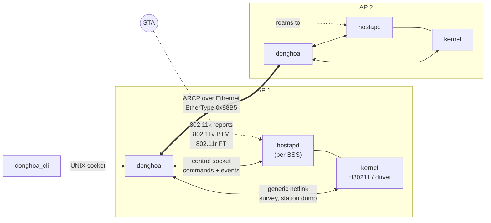
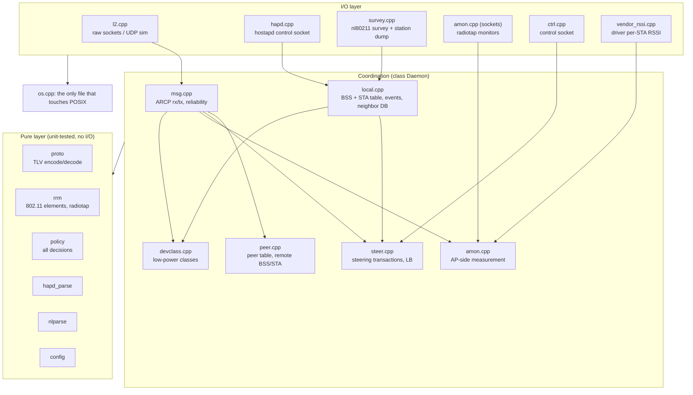

# DongHoa feature guide

One document per feature: what it does, how data flows through it, the
algorithm with its formulas and constants, diagrams, configuration, failure
handling, how to observe it, and how it is tested. Default values are shown
in brackets, e.g. `rssi_low` [−75 dBm].

These documents explain. The reference documents they link to define:

| Document | Role |
|---|---|
| [../PROTOCOL.md](../PROTOCOL.md) | ARCP wire format: header, TLVs, messages (normative) |
| [../SRS.md](../SRS.md) | Requirements (FR-*, NFR-*, IR-*) and configuration keys |
| [../SDD.md](../SDD.md) | Software design: modules, data, sequences, decisions, risks |
| [../ARCHITECTURE.md](../ARCHITECTURE.md) | Layering, state machine, hostapd assumptions |
| [../STEERING.md](../STEERING.md) | One-page steering flow |
| [../CODING_CONVENTION.md](../CODING_CONVENTION.md) | C++17 / MISRA-based rules |

## Features

| # | Document | In one sentence |
|---|---|---|
| 1 | [Transport and messaging](01-transport-messaging.md) | Raw-Ethernet ARCP frames, HMAC authentication, replay window, reliable unicast, automatic backhaul failover |
| 2 | [Peer discovery and state exchange](02-peer-discovery.md) | APs find each other with HELLO and share BSS, load, STA and radio state |
| 3 | [802.11k neighbor reports](03-neighbor-reports.md) | Every BSS's hostapd neighbor database fills itself from the peers |
| 4 | [Local monitoring](04-local-monitoring.md) | hostapd and nl80211 give BSS status, channel utilisation and per-STA metrics |
| 5 | [Steering engine](05-steering-engine.md) | One transaction per STA: trigger → pool → measure → score → negotiate → BTM → roam |
| 6 | [RSSI roaming](06-rssi-roaming.md) | A STA with a weak signal is moved to a BSS it hears better |
| 7 | [Band steering](07-band-steering.md) | A STA close to the AP is moved from 2.4 GHz to 5 GHz, or from 5 GHz to 6 GHz |
| 8 | [Load balancing](08-load-balancing.md) | An overloaded BSS offloads STAs, with admission control, reservations and a feedback check |
| 9 | [AP-side measurement](09-ap-side-measurement.md) | STAs without 802.11k are measured by the other APs (monitor or driver API) |
| 10 | [Low-power device classification](10-low-power-classification.md) | IoT devices are recognised from their traffic and kept out of automatic steering |
| 11 | [Wi-Fi 7 MLO awareness](11-mlo.md) | AP MLDs and MLD STAs are handled as one device, never steered between their own links |
| 12 | [Control interface and logging](12-control-logging.md) | `donghoa_cli` commands and per-module logging |
| 13 | [Configuration and OpenWrt integration](13-configuration-openwrt.md) | Config file, UCI-generated `bss` lines, procd service, package |
| 14 | [Verification](14-verification.md) | Unit tests, integration test, QEMU system test, what each one proves |

## System overview

Each AP runs one `donghoa` next to its `hostapd`. The daemons talk to each
other over ARCP on the LAN; each one talks to its own hostapd over the
control socket and to the kernel over nl80211.

## Inside one daemon

A single thread runs a `poll()` loop with a 100 ms tick (`src/main.cpp`). All
state lives in fixed arrays of the one `Daemon` object; there is no heap, no
exceptions and no RTTI. The coordination code is split by feature across
files, all member functions of `Daemon`.

## Timers in the main loop

| Timer | Default | Runs |
|---|---|---|
| STA poll | `sta_poll_interval_ms` [1000] | `pollBss` (hostapd `STATUS`), `pollStas` (station dump or hostapd listing) |
| HELLO | `hello_interval_ms` [2000] | `sendHello` |
| BSS status | `bss_status_interval_ms` [5000] | `sendBssStatus` |
| STA status | `sta_status_interval_ms` [10000] | `sendStaStatus` |
| RF status | `rf_status_interval_ms` [10000] | `sendRfStatus` |
| Load balancing | `lb_interval_ms` [10000] | `runLbRound` |
| Every tick | 100 ms | `tickSteer`, `tickAmon`, survey timeout, `retransmit`, `expirePeers` |

## Glossary

| Term | Meaning |
|---|---|
| AP | One access point, running one `donghoa` and one `hostapd` |
| BSS | One Wi-Fi network instance (one BSSID) on one radio; an AP has several |
| ESS | All BSSes with the same SSID; steering stays inside one ESS |
| STA | A client device |
| Source AP | The AP the STA is on when a steer starts; it runs the transaction |
| Target AP | The AP that owns the chosen candidate BSS |
| RCPI | Received Channel Power Indicator in 802.11k reports; dBm = RCPI/2 − 110 |
| BTM | 802.11v BSS Transition Management Request/Response |
| FT | 802.11r Fast BSS Transition |
| MLD / MLO | Wi-Fi 7 Multi-Link Device / Operation |
| TU | Time unit, 1.024 ms |
